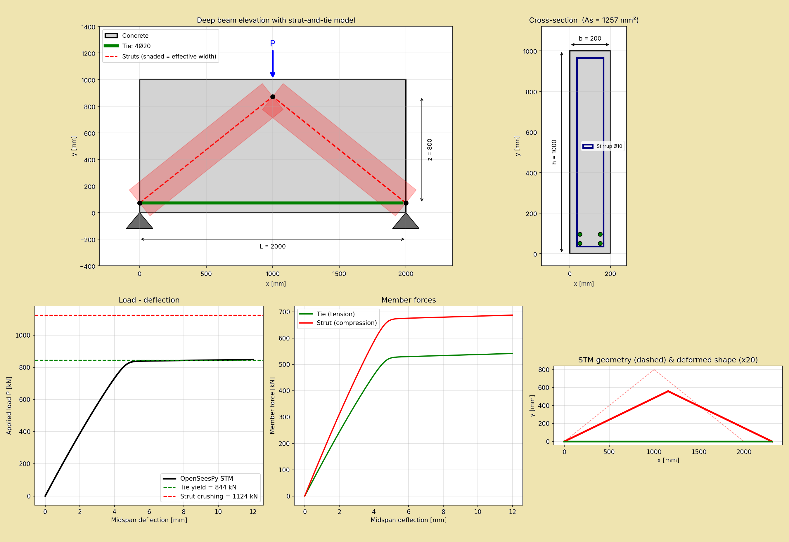

# NONLINEAR STRUT-AND-TIE MODEL OF A CONCRETE DEEP BEAM IN OPENSEESPY 
# مدل غیرخطی تیر عمیق بتنی (خرپایی) در OpenSeesPy

 

The script models a concrete deep beam as a three-node strut-and-tie truss in OpenSeesPy, in N, mm and MPa. The inputs at the top set the span, lever arm, beam thickness, effective strut width, concrete strength with a softening factor of 0.6, and the tie steel (4Ø20 bars). It then builds a 2D, 2-DOF-per-node model. Node 1 is a pin and node 2 a roller at the supports, and node 3 is the load point at top midspan. The two inclined `corotTruss` elements from the supports to the load point carry the concrete arch action, using `Concrete01`, which has no tension capacity. The bottom `corotTruss` between the supports carries the tension, using `Steel02` with strain hardening. A unit downward load is applied at node 3, and the analysis uses `DisplacementControl` on that node's vertical DOF, so the load rises until the tie yields and the full load-deflection curve is traced. Newton iteration is used, with a fallback to `ModifiedNewton` if a step fails. At each step the code records the midspan deflection, the applied load (taken from the sum of the support reactions) and the axial forces in the strut and tie. It then compares the result with hand calculations: the tie-yield load of 2·As·fy·tanθ (about 844 kN) and the strut-crushing load of 2·β·fc·A·sinθ (about 1124 kN). Because the tie governs, the OpenSees peak of about 848 kN, slightly above the tie-yield load because of steel hardening, shows a ductile flexural-type failure. Finally it plots three panels: load against deflection with the two capacity lines, member forces against deflection, and the original and deformed truss geometry.
