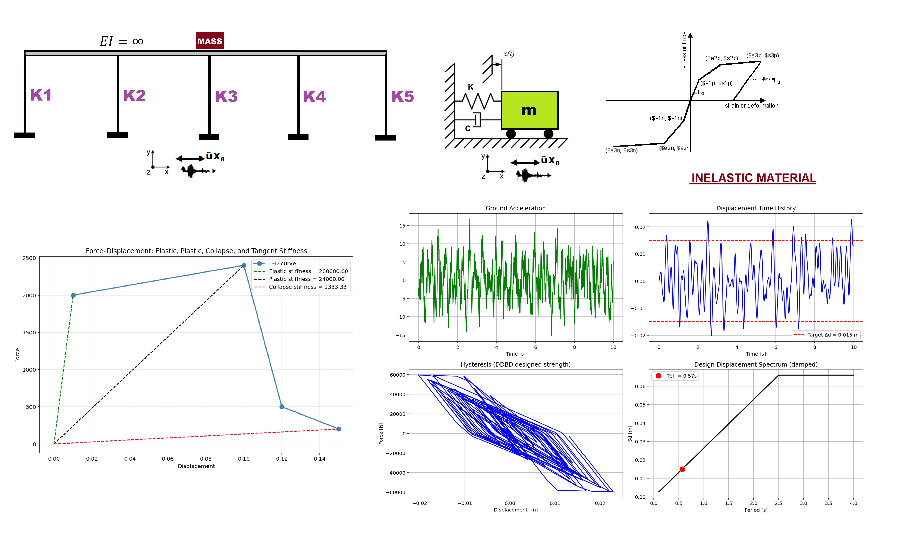

# DIRECT DISPLACEMENT-BASED DESIGN (DDBD) OF A SDOF SYSTEM WITH NONLINEAR DYNAMIC TIME-HISTORY IN OPENSSEES 

This Python script implements Direct Displacement-Based Design (DDBD) for a single-degree-of-freedom (SDOF) system and verifies it with nonlinear dynamic time-history analysis in OpenSeesPy. It begins by defining a target displacement, estimating ductility and equivalent viscous damping, then constructs a multilinear force-displacement backbone that is scaled so the yield strength matches the base shear required by DDBD; an effective period is found by intersecting the target displacement with a damped design displacement spectrum. Parallel zero-length hysteretic springs representing the scaled backbone, together with Rayleigh damping and a scaled ground-motion record, are assembled into an OpenSees model that is subjected to transient analysis; the resulting displacement history, hysteresis loops, and design spectrum are finally plotted to compare the achieved peak displacement against the DDBD target.

 
