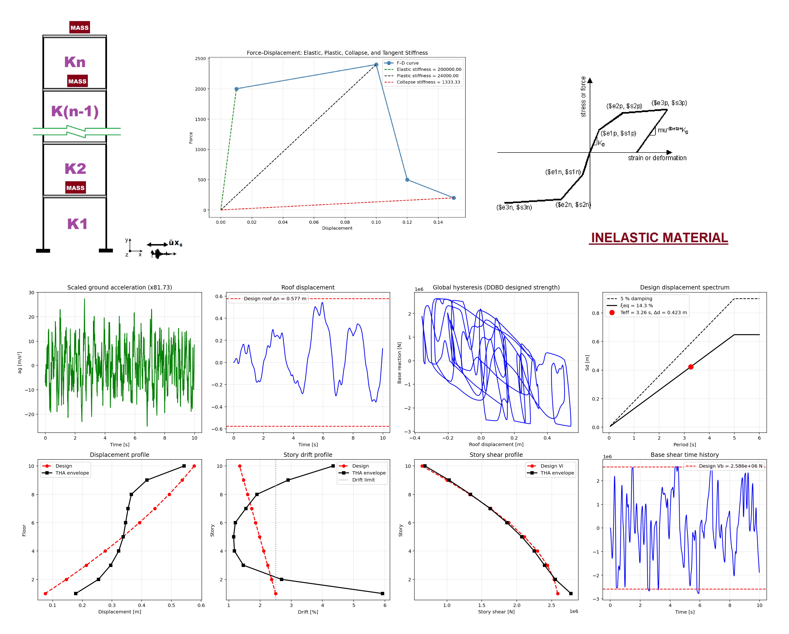

# DIRECT DISPLACEMENT-BASED DESIGN (DDBD) OF A MDOF SHEAR BUILDING WITH NONLINEAR TIME-HISTORY IN OPENSEES
# طراحی مستقیم مبتنی بر جابجایی یک ساختمان برشی چند درجه آزادی با تحلیل تاریخچه زمانی غیرخطی در نرم‌افزار اوپنسیس

This Python script implements Direct Displacement-Based Design (DDBD) for a multi-degee-of-freedom (MDOF) system and
 verifies it with nonlinear dynamic time-history analysis in OpenSeesPy. It begins by defining a target displacement,
 estimating ductility and equivalent viscous damping, then constructs a multilinear force-displacement backbone that is
 scaled so the yield strength matches the base shear required by DDBD; an effective period is found by intersecting the
 target displacement with a damped design displacement spectrum. Parallel zero-length hysteretic springs representing the
 scaled backbone, together with Rayleigh damping and a scaled ground-motion record, are assembled into an OpenSees model
 that is subjected to transient analysis; the resulting displacement history, hysteresis loops, and design spectrum are
 finally plotted to compare the achieved peak displacement against the DDBD target.
 
DDBD of an N-storey shear building (Priestley, Calvi & Kowalsky 2007) verified by nonlinear time-history.

PROCEDURE
  1. Design displacement profile  Delta_i  (inelastic shape + higher-mode drift reduction omega_theta)
  2. Substitute (equivalent SDOF) structure:   Delta_d, m_e, H_e
  3. Yield displacement  Delta_y = theta_y * H_e   ->   ductility mu   ->   equivalent damping xi_eq
  4. Effective period T_eff from the xi_eq-damped design displacement spectrum at Delta_d
  5. Effective stiffness K_e = 4 pi^2 m_e / T_eff^2   ->   design base shear V_b = K_e * Delta_d
  6. Distribute V_b to the floors:  F_i = F_t + (V_b - F_t) * m_i*Delta_i / sum(m_j*Delta_j)
     -> story shears V_i -> story strengths (STORY_COFF scale factors of the shared backbone)
  7. Verify with nonlinear time-history (OpenSeesPy, reuses MDOF_DYNAMIC_TIME_HISTORY.py), the record
     being scaled so that its xi_eq-damped linear Sd(T_eff) equals the design spectrum at T_eff.

SIMPLIFICATIONS (flagged, change them if your code requires it)
  - P-Delta is ignored (Priestley: V_b -= C*P*Delta_d/H_e)
  - Constant story height and the same yield drift theta_y in every story
  - Rayleigh damping in the THA is the ELASTIC 5 % only; the hysteretic energy is already in the spring
    (using xi_eq in the THA would count the damping twice)

  
