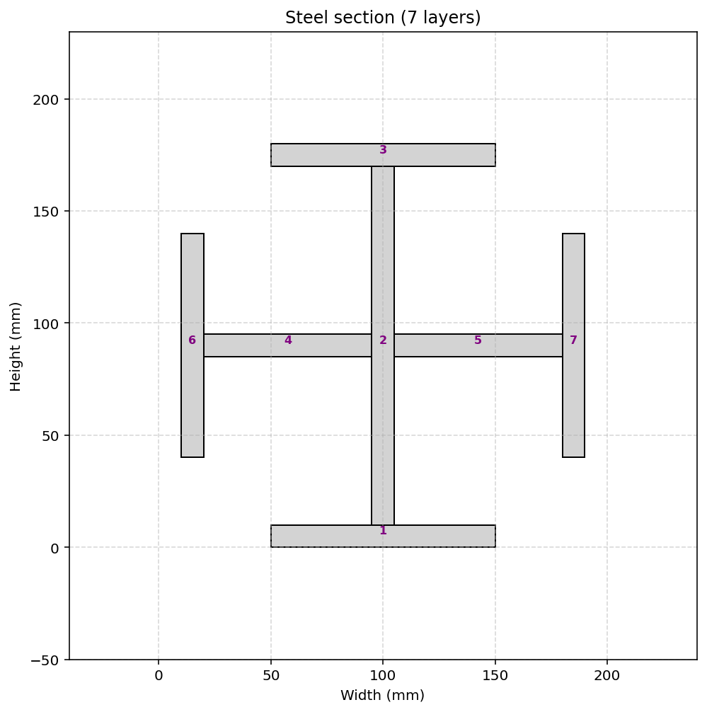
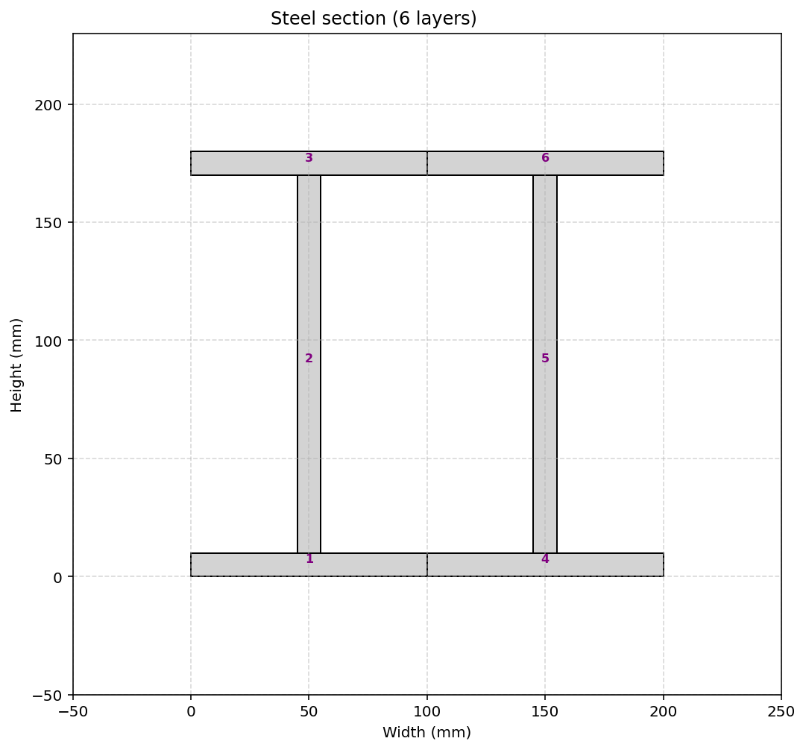
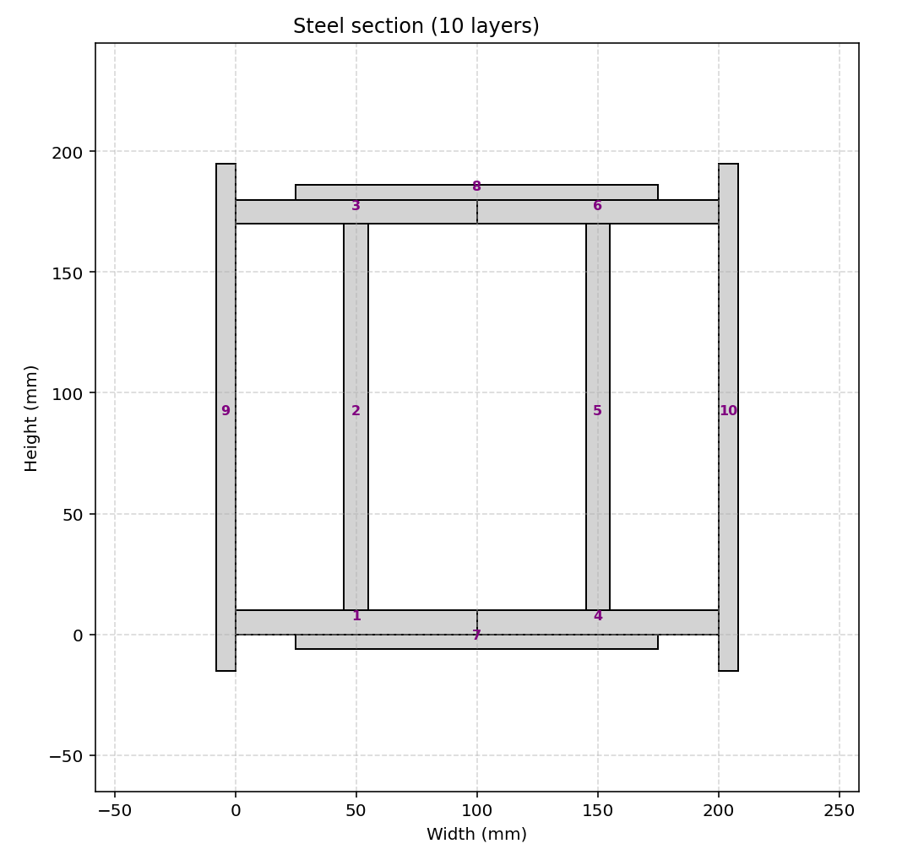
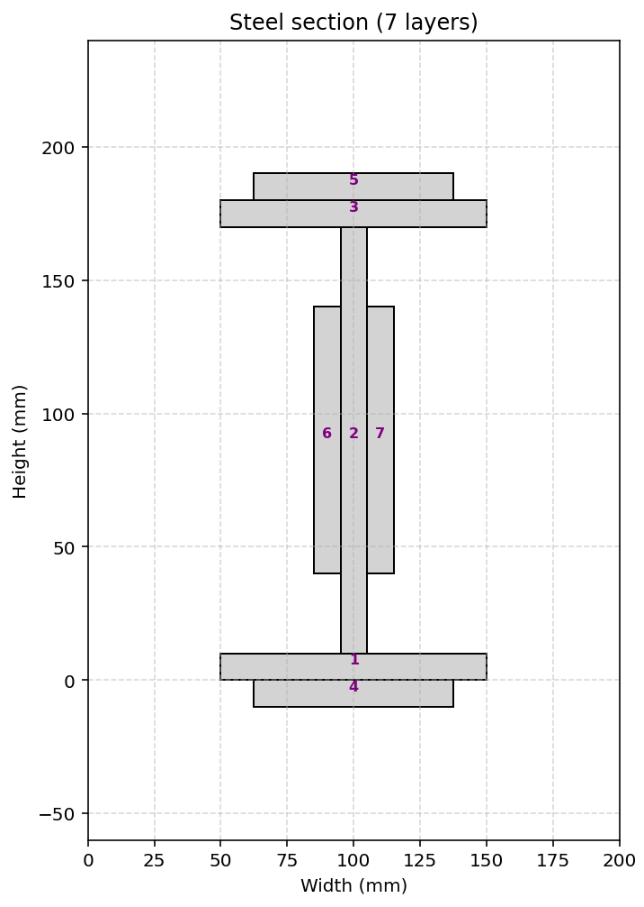
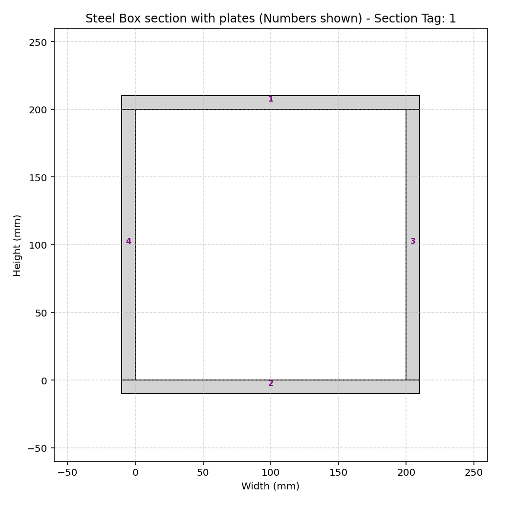
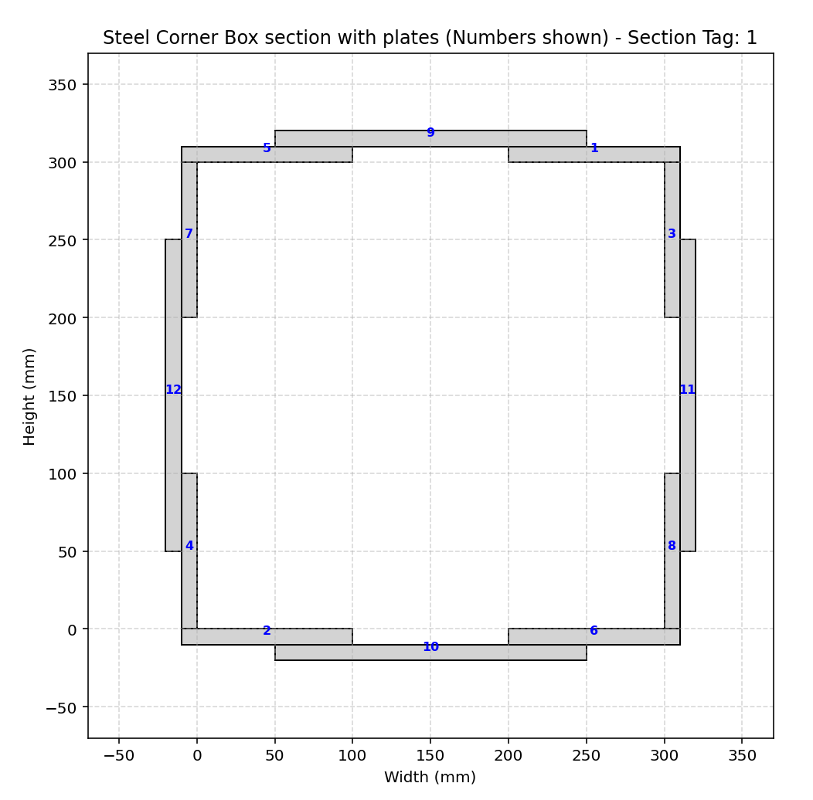

# COMPREHENSIVE NONLINEAR SEISMIC ASSESSMENT OF A STEEL BRACED FRAME : AN OPENSEES FRAMEWORK FOR STATIC PUSHOVER, CYCLIC DEGRADATION, STATIC TIME-HISTORY AND DYNAMIC TIME-HISTORY ANALYSIS

 

# CROSS_SHAPED_STEEL_SECTION_DIFF_WIDTH_HEIGHT_FUN_EXTRA
 
# DOUBLE_I_STEEL_SECTION_DIFF_WIDTH_HEIGHT_FUN_EXTRA

# PLATE_DOUBLE_I_STEEL_SECTION_DIFF_WIDTH_HEIGHT_FUN_EXTRA

# I_STEEL_PLATE_SECTION_DIFF_WIDTH_HEIGHT_FUN_EXTRA

# STEEL_BOX_SECTION_DIFF_WIDTH_HEIGHT_FUN_EXTRA

# STEEL_CORNER_BOX_SECTION_DIFF_WIDTH_HEIGHT_FUN_EXTRA

