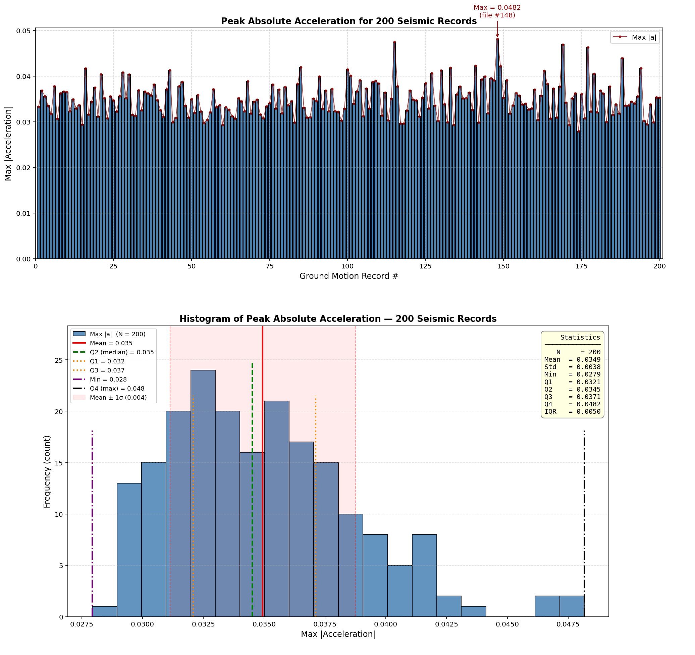

# PARAMETRIC NONLINEAR SEISMIC DEMAND SPECTRA OF A 2-DOF (X & Y SPRINGS) SYSTEM UNDER 20 GROUND MOTIONS (EACH APPLIED IN X AND Y) WITH CONSTANT DUCTILITY CAPACITY IN OPENSEES

#  طیف‌های تقاضای لرزه‌ای غیرخطی پارامتریک یک سیستم دو درجه آزادی (با فنرهای X و Y) تحت دو شتاب‌نگاشت زلزله با ظرفیت شکل پذیری متغیر

This script builds a 2-DOF OpenSeesPy structure (`-ndm 2 -ndf 2`) with a fixed base node and a mass node, joined by one `zeroLength` element that holds an independent hysteretic spring and viscous damper in X and in Y. In your version the two springs differ (X: FY = 6.5 MN, Ke = 350 MN/m; Y: FY = 8.5 MN, Ke = 450 MN/m), so the X and Y periods are not equal. The ductility is constant at `DUCT = 10`, so each spring's ultimate displacement is `DSU = DUCT * DY`, about 0.186 m in X and 0.189 m in Y, and the damping ratio is fixed at 3%. It first runs a cyclic displacement protocol (amplitude DSU) on each spring, once, to get the baseline dissipated energy (loop area by the shoelace formula). It then loops over 20 ground-motion pairs. Record g is applied in X and record g + 1 (wrapping around) in Y, at the same time, through two `UniformExcitation` patterns in a nonlinear Newmark time-history analysis. For each pair, an inner loop sweeps the mass, which changes the elastic period, so each pair gives one demand spectrum per direction. For every run and each direction it extracts the peak displacement, velocity, acceleration and base reaction, the ductility damage index, the stiffness and the damping ratio from logarithmic decrement. It also computes the Energy Dissipation Capacity Index (earthquake dissipated energy as a percentage of the cyclic baseline) and the equivalent viscous damping ratio (dissipated energy divided by 4π times the strain energy). The 20 curves are plotted against period with mean, median, quartile and ± standard-deviation bands, and everything is exported to Excel. All points from all records and masses are pooled for histograms, fragility curves, scatter and cluster plots, random forest, a correlation heatmap and multiple regression, separately for X and Y. The script ends with hysteresis loops, time histories and an X-Y displacement orbit for the last run only. The header and some comments still say 20 records and `_20.txt`.

MODEL (OpenSeesPy):
    ops.model('basic', '-ndm', 2, '-ndf', 2)
    Node 1 : fixed base (both DOFs fixed)
    Node 2 : mass node  (DOF 1 = X, DOF 2 = Y)
    One zeroLength element carrying
        - X spring (Hysteretic or Elastic)   + X viscous damper  -> direction 1
        - Y spring (Hysteretic or Elastic)   + Y viscous damper  -> direction 2
    The X and Y springs are independent (uncoupled) and can have different FY, Ke and OSF (see SPRING).

CONSTANT DUCTILITY CAPACITY:
    DSU = DUCT * DY,  DY = FY / Ke   with ONE fixed DUCT for both springs (the damping ratio is also fixed).
    Because DSU is constant, the cyclic baseline (Ed_CP) is computed once per direction.

LOADING (100 GROUND MOTIONS IN X AND Y):
    NUM_GM = 100 records Ground_Acceleration_1.txt ... Ground_Acceleration_20.txt (values in g).
    Analysis g applies record g in X (DOF 1) and record (g + GM_SHIFT) mod NUM_GM in Y (DOF 2) at the same time
    (two UniformExcitation patterns). GM_SHIFT = 0 applies the same record in both directions.
    For each pair the mass sweep (period sweep) gives one nonlinear demand spectrum -> 20 spectra per direction.

PER-DIRECTION OUTPUTS (X and Y):
    displacement, velocity, acceleration, base reaction, ductility damage index (DI), damping ratio,
    stiffness, energy dissipation capacity index (EDCI) and equivalent viscous damping ratio (EVDR).

EDCI   = 100 * Ed(earthquake) / Ed(cyclic displacement protocol)   (computed separately for X and Y)

EVDR   = 100 * Ed / (4*pi*Es),  Es = 0.5*Fmax*umax

DI     = (Dd - Dy) / (Du - Dy)

# 200 SEISMIC GROUND MOTIONS ANALYSIS

Please note that the content may not be entirely free of errors or inaccuracies.

THESE PYTHON SCRIPTS ARE WRITTEN BY SALAR DELAVAR GHASHGHAEI (QASHQAI)
