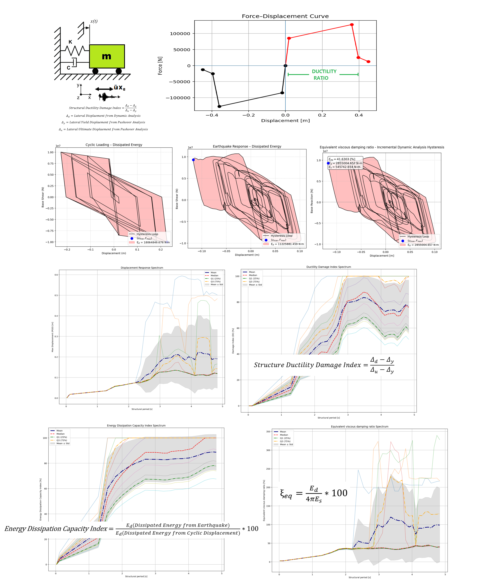

# PARAMETRIC NONLINEAR SEISMIC DEMAND SPECTRA OF A SINGLE-DEGREE-OF-FREEDOM (SDOF) SYSTEMS WITH VARIABLE DUCTILITY CAPACITY IN OPENSEES
# طیف‌های تقاضای لرزه‌ای غیرخطی پارامتریک سیستم‌های یک‌درجه‌آزادی با ظرفیت شکل‌پذیری متغیر در اوپنسیس

 

 # ANALYSIS STEPS — SDOF Ductility Response Spectrum with EDCI & EVDR
 # -------------------------------------------------------------------------
 1. Model initialization: define SDOF mass (150,000 kg), elastic stiffness
    (450 MN/m), yield force (8.5 MN), and ultimate displacement based on
    target ductility capacity.  Set Rayleigh damping ratio (3%) for the
    fundamental mode.
 2. Hysteresis characterization: build a pinched, strength-degrading
    HYSTERETICSM backbone (or bilinear alternative) from yield displacement
    and ultimate capacity to capture cumulative damage effects.
 3. Cyclic displacement protocol: apply a laboratory-style displacement
    history to the SDOF oscillator under static loading, recording base
    shear vs. displacement to establish the baseline energy dissipation
    capacity of the component.
 4. Baseline energy quantification: compute the enclosed hysteresis area
    Ed,cyclic via the Shoelace formula (exact) or convex hull (upper bound),
    and store it as the reference capacity for the EDCI.
 5. Eigenvalue analysis: after each cyclic step, extract the instantaneous
    period (T = 2π√(m/k)) to track stiffness degradation and period elongation.
 6. Dynamic time-history setup: switch to a nonlinear Newmark integration
    scheme (Newton-Raphson, 1e-6 tolerance, 1e6 max iterations) and apply
    the selected ground motion as a uniform base excitation.
 7. Parametric sweep over mass (hence period): repeat the dynamic analysis
    for a grid of SDOF masses (30 period points) to generate the inelastic
    response spectrum across the period range of interest.
 8. Peak response extraction: record maximum absolute displacement, velocity,
    acceleration, and base reaction from the time-history for each period.
 9. Ductility Damage Index (DDI): compute DI = (Dd − Dy)/(Du − Dy) using
    the peak dynamic displacement Dd, yield displacement Dy, and ultimate
    displacement Du to classify elastic, repairable, or collapse states.
 10. Energy Dissipation Capacity Index (EDCI): compare the hysteretic energy
     absorbed during the earthquake Ed,eq to the cyclic baseline Ed,cyclic,
     expressed as EDCI = 100 × Ed,eq / Ed,cyclic.
 11. Equivalent Viscous Damping Ratio (EVDR): evaluate ξeq = 100 × Ed /
     (4π Es) using the secant stiffness at peak displacement, providing a
     damping measure for capacity-spectrum assessment.
 12. Statistical post-processing: aggregate peak responses across the mass
     sweep to compute mean, median, quartiles, and standard deviation of
     each demand parameter (DDI, EDCI, EVDR, spectral ordinates).
 13. Spectrum construction: plot displacement, velocity, acceleration, base
     reaction, DDI, EDCI, and EVDR spectra as functions of natural period,
     overlaying the statistical envelopes for uncertainty quantification.
 14. Damage-state fragility: map DDI thresholds onto the response spectra
     to generate probabilistic fragility curves for performance-based
     earthquake engineering decisions.
 15. Data export: write all peak and time-history results to Excel/CSV
     for parametric studies, sensitivity analyses, and machine-learning
     based damage prediction.
     
This Python/OpenSeesPy script performs a parametric nonlinear time-history analysis of single-degree-of-freedom (SDOF) systems with constant yield strength and variable ductility capacity, first running a cyclic displacement protocol to establish a baseline dissipated energy capacity, then subjecting the same system to a selected ground motion while sweeping mass (and therefore period) to generate inelastic response spectra for displacement, velocity, acceleration, base reaction, ductility damage index, stiffness, damping ratio, energy dissipation capacity index, and equivalent viscous damping ratio; it computes damage and energy-based metrics, exports the peak response data to Excel, visualizes spectra with statistical summaries (mean, median, quartiles, standard deviation), so it is more accurately described as a parametric nonlinear seismic demand spectrum study with variable ductility capacity.

# 200 SEISMIC GROUND MOTIONS ANALYSIS

THIS PYTHON SCRIPTS ARE WRITTEN BY SALAR DELAVAR GHASHGHAEI (QASHQAI)
