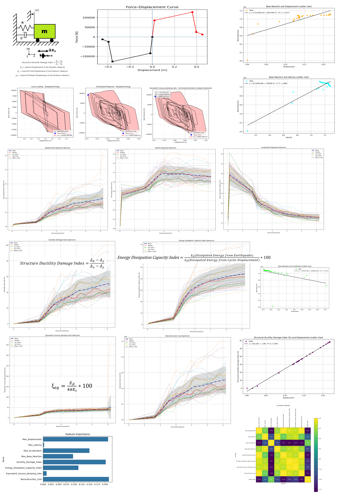
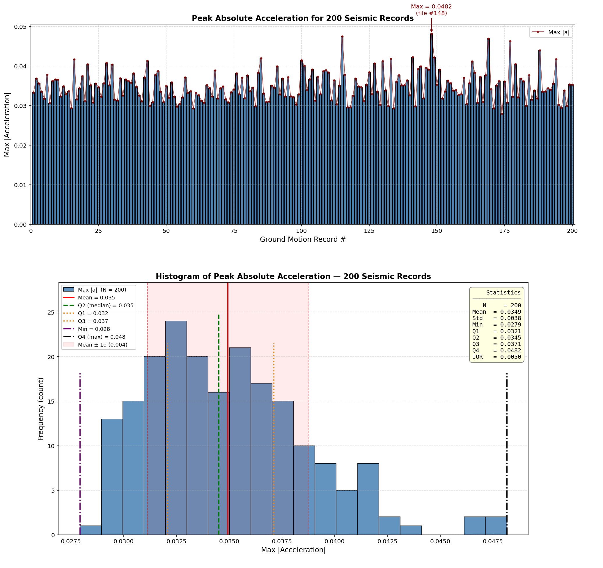
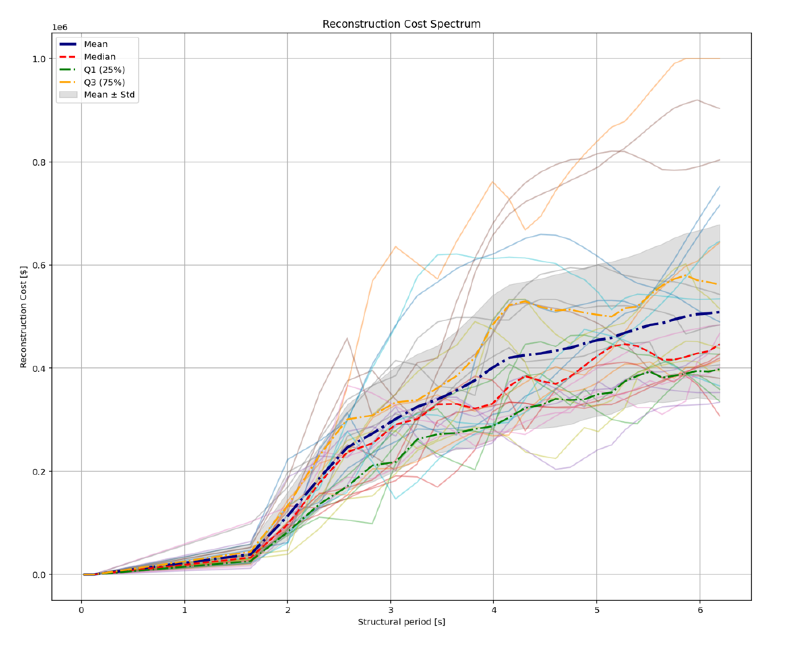

# NONLINEAR DYNAMIC ANALYSIS OF A SINGLE-DEGREE-OF-FREEDOM (SDOF) SYSTEM UTILIZING 30 GROUND MOTIONS IN OPENSEES AND EVALUATION OF SEISMIC RESPONSE SPECTRUM 

# تحلیل دینامیکی غیرخطی یک سیستم با یک درجه آزادی با استفاده از ۳۰ حرکت زمین در اوپنسیس و ارزیابی طیف پاسخ لرزه‌ای
This Python script is the main driver of a comprehensive OpenSeesPy framework for nonlinear dynamic (time-history) analysis of a single-degree-of-freedom (SDOF) system under approximately 30 earthquake records.

The program builds an SDOF structural model (with the option to consider soil–structure interaction), performs inelastic response-spectrum analyses at different seismic intensity levels, and computes the following key performance indicators:

- Ductility vulnerability index (DDI)
- Energy dissipation capacity index (EDCI = 100 × earthquake dissipated energy / cyclic dissipated energy)
- Equivalent viscous damping ratio (EVDR = 100 × dissipated energy / (4π × strain energy))
- Reconstruction cost response spectrum

Helper functions include:

- Eigenvalue analysis
- Rayleigh damping
- Definition of hysteretic materials
- Bilinear idealization of capacity curves
- Free-vibration and pushover analyses to extract effective properties
- Fragility curves
- Reconstruction cost calculation
- Extensive post-processing (plots, Excel reports, PDF, and PowerPoint)

The overall aim of this framework is probabilistic seismic performance assessment of SDOF systems considering ground-motion uncertainty and computing various response spectra.

Since the structure was assumed to be inelastic and the response spectra were then plotted for the energy dissipation capacity index, this shows the natural period beyond which an increase in the structure’s period leads to a higher probability of failure

 

# 200 SEISMIC GROUND MOTIONS ANALYSIS

# RECONSTRUCTION COST SPECTRUM
 

Please note that the content may not be entirely free of errors or inaccuracies.

THIS PYTHON SCRIPT IS WRITTEN BY SALAR DELAVAR GHASHGHAEI (QASHQAI)
