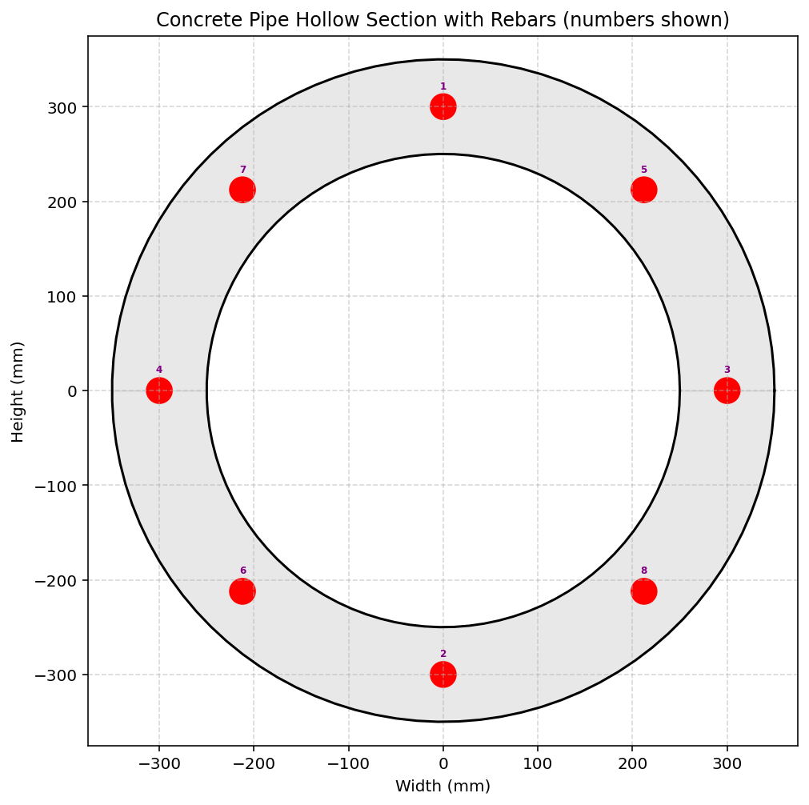
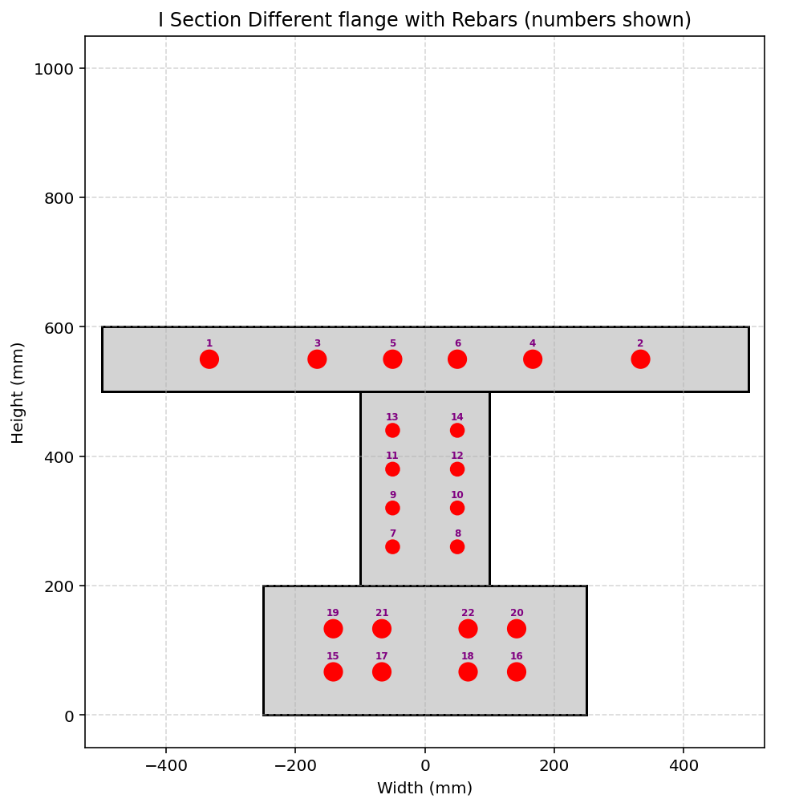
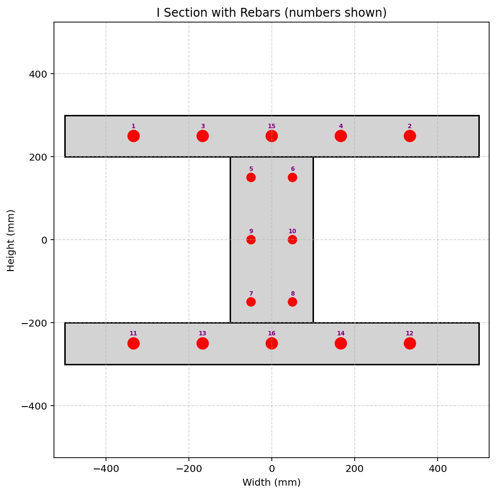
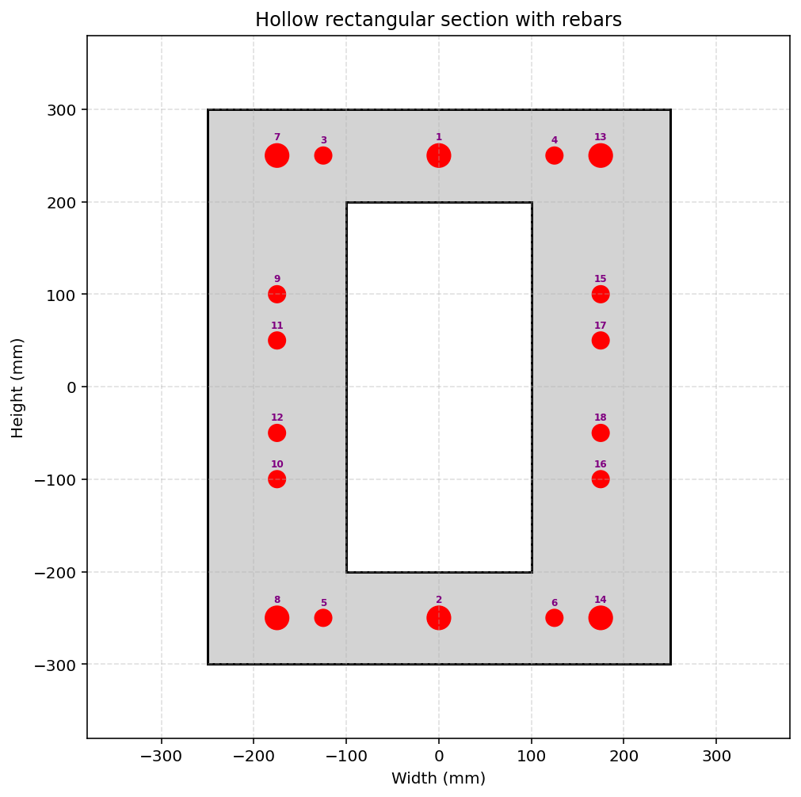
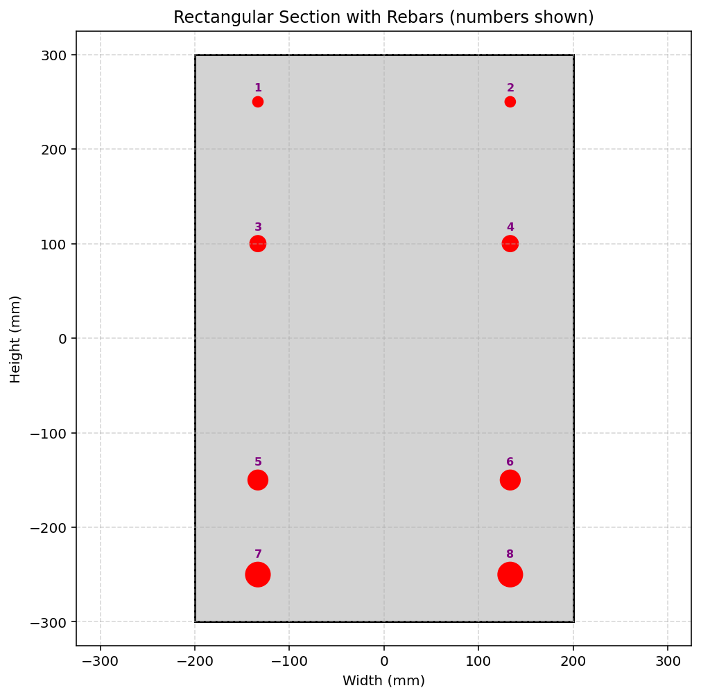
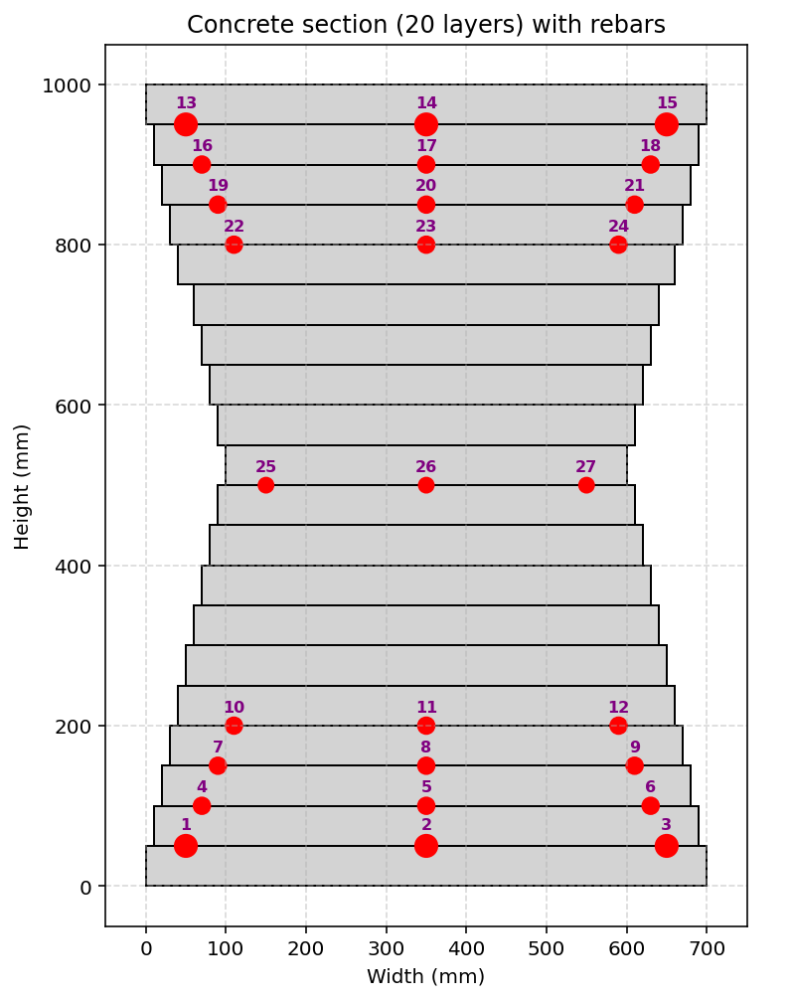
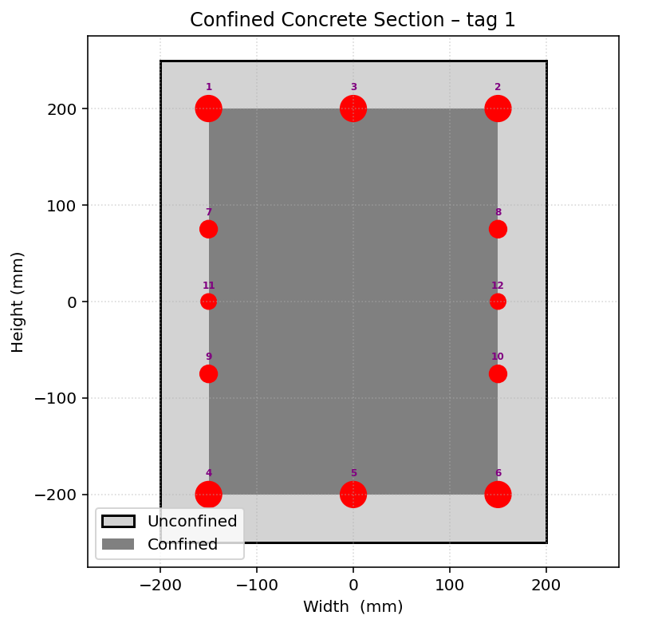
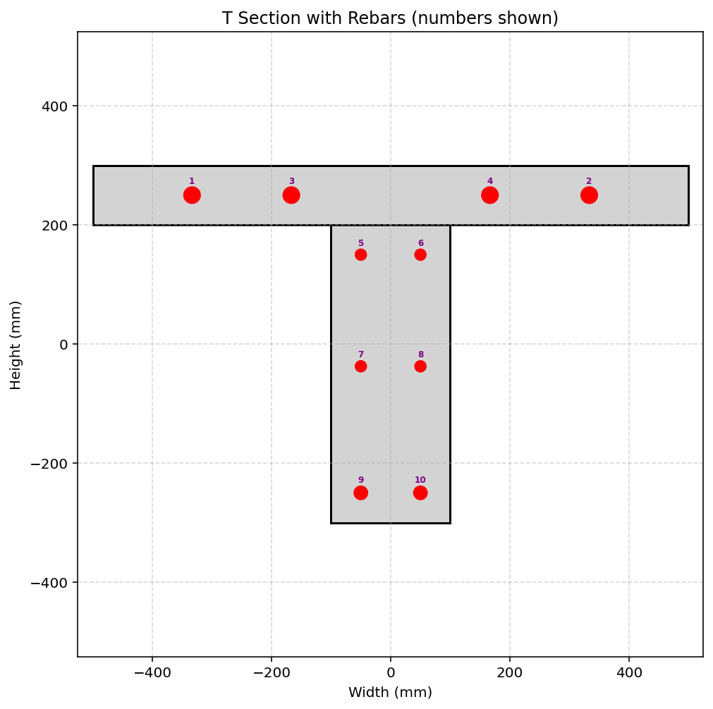

# COMPREHENSIVE NONLINEAR SEISMIC ASSESSMENT OF A CONCRETE SECTION FRAME : AN OPENSEES FRAMEWORK FOR STATIC PUSHOVER, CYCLIC DEGRADATION, STATIC TIME-HISTORY AND DYNAMIC TIME-HISTORY ANALYSIS

# ارزیابی جامع غیرخطی سازه بتنی : چارچوبی مبتنی بر اوپنسیس در پایتون برای تحلیل پوش‌آور استاتیکی، تحلیل چرخه‌ای همراه با کاهش سختی، تحلیل تاریخچه زمانی استاتیکی و دینامیکی، با در نظر گرفتن شاخص‌های آسیب شکل‌پذیری در المان و سازه و ارزیابی شاخص ظرفیت انرژی اتلاف‌شده

 

# CONCRETE_CIRCULALR_HOLLOW_PIPE_SECTION_FUN

# CONCRETE_I_SECTION_DIFF_FLANGE_FUN_EXTRA

# CONCRETE_I_SECTION_FUN_EXTRA

# CONCRETE_RECTANGULAR_HOLLOW_SECTION_FUN

# ONCRETE_REC_SECTION_FUN_EXTRA

# CONCRETE_SECTION_DIFF_WIDTH_HEIGHT_FUN_EXTRA

# CONCRETE_SECTION_FUN_NEW

# CONCRETE_T_SECTION_FUN_EXTRA

