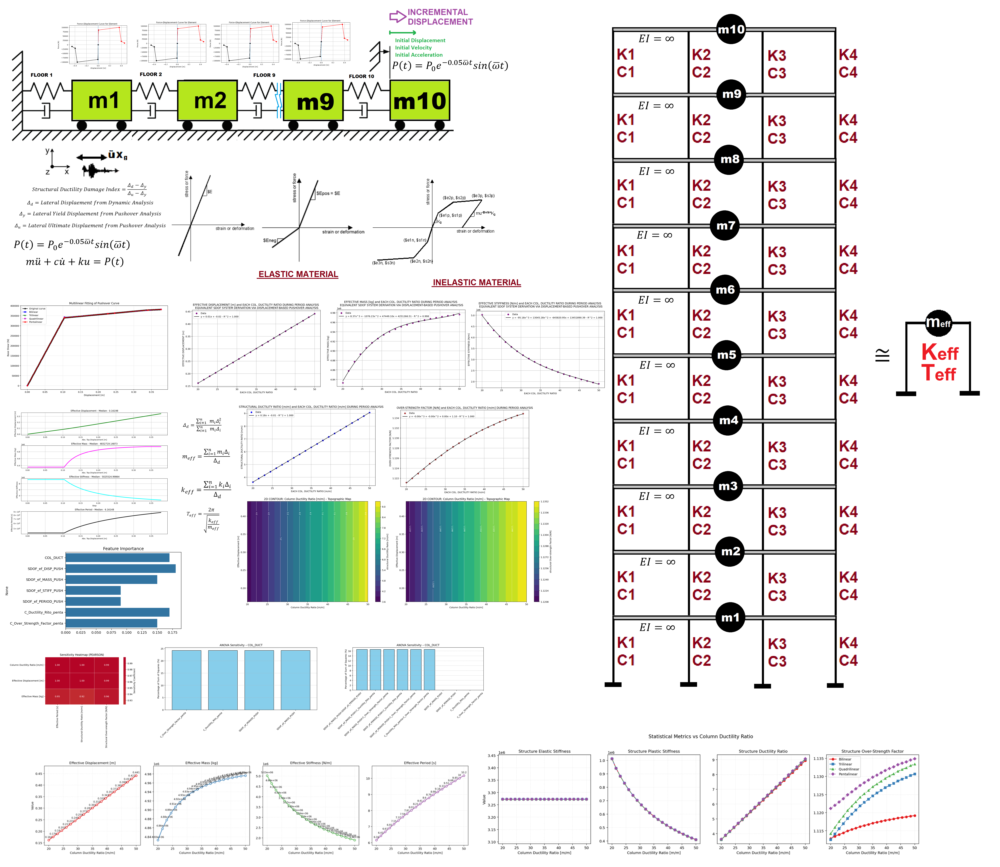
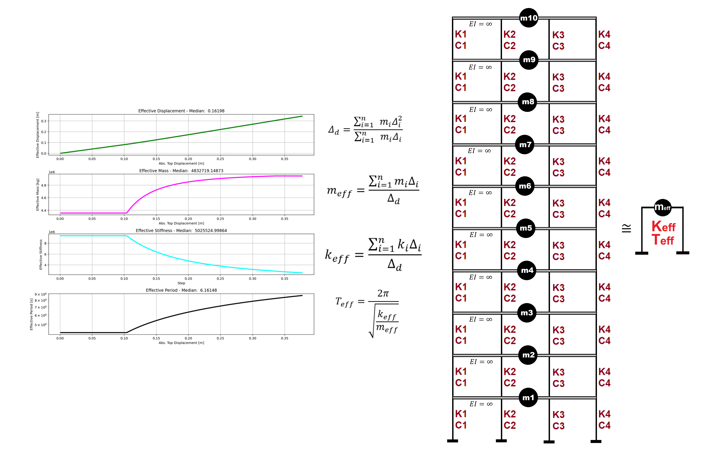

# SENSITIVITY ANALYSIS OF COLUMN DUCTILITY RATIO AND OPENSEES VIA PUSHOVER ANALYSIS OF A MULTI-DEGREE-OF-FREEDOM STRUCTURE AND EVALUATION OF A MULTILINEAR FITTING CURVE FOR STRUCTURAL ELASTIC STIFFNESS, PLASTIC STIFFNESS, DUCTILITY RATIO, AND OVER-STRENGTH FACTOR COMPREHENSIVE NONLINEAR SEISMIC ASSESSMENT OF A MULTI-DEGREE-FREEDOM (MDOF) STRUCTURE: AN OPENSEES FRAMEWORK FOR STATIC PUSHOVER, CYCLIC DEGRADATION, STATIC TIME-HISTORY AND DYNAMIC TIME-HISTORY ANALYSIS     

# تحلیل حساسیت نسبت شکل‌پذیری ستون و نرم‌افزار اوپن‌سیس از طریق تحلیل پوش‌آور یک سازه چند درجه آزادی، همراه با ارزیابی منحنی برازش چندخطی برای سختی کشسان سازه، سختی خمیری، نسبت شکل‌پذیری و ضریب مقاومت افزون؛ ارزیابی جامع غیرخطی لرزه‌ای یک سازه چند درجه آزادی: چارچوبی در اوپن‌سیس برای تحلیل پوش‌آور استاتیکی، افت چرخه‌ای، تاریخچه زمانی استاتیکی و تحلیل تاریخچه زمانی دینامیکی.

**OpenSeesPy | Nonlinear Pushover Analysis | Displacement-Based Seismic Assessment | Multilinear Capacity-Curve Idealization**

This project investigates the influence of column ductility on the nonlinear lateral response of a ten-story, multi-degree-of-freedom (MDOF) structural model. The computational framework combines OpenSeesPy pushover simulations, equivalent single-degree-of-freedom (SDOF) transformation, capacity-curve idealization, structural response metrics, and sensitivity visualization.

> **Scope:** This project is intended for educational and research purposes. Its simplified model assumptions and numerical procedures must be independently verified before the results are used in engineering design or assessment.

## 1. PROJECT OVERVIEW

The main script, `DUCT_SENSITIVITY_PUSHOVER_MDOF.py`, performs nonlinear structural analysis for a range of column ductility ratios. The resulting force–displacement responses are processed to investigate how ductility influences global structural behavior and the parameters obtained from different capacity-curve idealizations.

### Research objectives

- Investigate the relationship between column ductility ratio and global pushover response.
- Evaluate the influence of ductility on yield displacement, ultimate displacement, and post-yield stiffness.
- Transform the MDOF pushover response into an equivalent SDOF representation using a displacement-based procedure.
- Calculate effective displacement, effective mass, effective stiffness, and effective period.
- Compare bilinear, trilinear, quadrilinear, and pentalinear idealizations of the pushover curve.
- Evaluate elastic stiffness, post-yield stiffness, ductility ratio, and overstrength factor.
- Visualize parameter trends using sensitivity plots, heatmaps, and contour plots.
- Support statistical sensitivity assessment using the included ANOVA-related utilities.

## 2. STRUCTURAL MODEL

The main script constructs a simplified ten-story shear-building model using OpenSeesPy.

| Model parameter | Current implementation |
|---|---|
| Number of stories | 10 |
| Lateral degrees of freedom | One per modeled floor |
| Lateral resisting components | Four parallel nonlinear zero-length springs per story |
| Floor mass | Lumped at floor nodes |
| Yield force per spring | 85,000 N |
| Ultimate-to-yield force ratio | 1.18 |
| Elastic stiffness per spring | 4.5 × 10⁶ N/m |
| Damping ratio input | 0.03 |
| Primary analysis | Displacement-controlled static pushover |
| Main sensitivity variable | Column/spring ductility ratio |

These values describe the current model configuration. They are not universal design values and should be reviewed in the source code before conducting additional analyses.

### 2.1 Ductility parameterization

The yield displacement is calculated from the elastic stiffness and yield force:

\[
\Delta_y=\frac{F_y}{K_e}
\]

The prescribed ultimate displacement is defined as:

\[
\Delta_u=\mu_c\Delta_y
\]

where:

- \(\Delta_y\) is the yield displacement.
- \(\Delta_u\) is the prescribed ultimate displacement.
- \(F_y\) is the yield force.
- \(K_e\) is the elastic stiffness.
- \(\mu_c\) is the prescribed column/spring ductility ratio.

The post-yield hardening stiffness is determined from the selected yield and ultimate force–displacement points:

\[
K_h=\frac{F_u-F_y}{\Delta_u-\Delta_y}
\]

Consequently, changing the ductility ratio also changes the prescribed deformation capacity and can change the post-yield stiffness. This dependency must be considered when interpreting the sensitivity results.

## 3. ANALYSIS METHODOLOGY

The computational workflow consists of the following stages:

1. Define structural, material, mass, and damping parameters.
2. Select a column ductility ratio from the prescribed parameter range.
3. Generate the ten-story OpenSeesPy model.
4. Perform nonlinear displacement-controlled pushover analysis.
5. Extract the control-node displacement and global base-shear response.
6. Calculate equivalent-SDOF properties using the implemented displacement-based transformation.
7. Fit the capacity curve using multiple piecewise-linear idealizations.
8. Extract structural response parameters from the fitted curves.
9. Generate sensitivity plots and statistical visualizations.
10. Repeat the analysis for the remaining ductility values and compare the results.

### Analysis workflow

\`\`\`mermaid
flowchart TD
    A[Define model parameters] --> B[Select ductility ratio]
    B --> C[Build OpenSeesPy model]
    C --> D[Run nonlinear pushover]
    D --> E[Extract capacity curve]
    E --> F[Equivalent SDOF transformation]
    E --> G[Multilinear curve fitting]
    F --> H[Calculate response metrics]
    G --> H
    H --> I[Sensitivity and statistical analysis]
    I --> J[Generate plots and outputs]
    J --> K[Next ductility value]
    K --> B
\`\`\`

## 4. EQUIVALENT SDOF SYSTEM DERIVATION VIA DISPLACEMENT-BASED SEISMIC DESIGN PROCEDURE WITH PUSHOVER ANALYSIS

The project includes utilities for estimating equivalent-SDOF properties from the MDOF pushover response.

The transformation is intended to provide a reduced representation of the nonlinear structural response for displacement-based seismic assessment.

The calculated quantities may include:

- Effective displacement.
- Effective mass.
- Effective stiffness.
- Effective period.
- Related response quantities used by the displacement-based procedure.

The transformation depends on the assumed displacement shape, normalization, and generalized-coordinate formulation. These assumptions must be checked in the implementation before the derived properties are used quantitatively.

An equivalent-SDOF period obtained from a nonlinear pushover transformation should not automatically be interpreted as the initial elastic fundamental period of the original MDOF structure.

## 5. MULTILINEAR CAPACITY-CURVE IDEALIZATION

The repository includes curve-fitting utilities for different piecewise-linear representations of the structural capacity curve.

| Idealization | Purpose |
|---|---|
| Bilinear | Represents the response using two principal linear branches |
| Trilinear | Introduces an additional branch to represent changes in stiffness |
| Quadrilinear | Provides a more detailed piecewise-linear representation |
| Pentalinear | Allows additional branches to represent more complex response trends |

The extracted parameters depend on the selected breakpoints, fitting criterion, and definition of yield and ultimate response.

### Structural parameters

| Parameter | Engineering interpretation |
|---|---|
| Elastic stiffness | Initial or fitted pre-yield slope |
| Post-yield stiffness | Slope of the fitted response beyond yielding |
| Ductility ratio | Displacement capacity relative to a defined yield displacement |
| Overstrength factor | Strength relative to a specified reference strength |
| Effective displacement | Generalized displacement of the equivalent SDOF system |
| Effective mass | Generalized mass associated with the adopted transformation |
| Effective stiffness | Stiffness derived from the equivalent-system formulation |
| Effective period | Period calculated from the equivalent-system properties |
| Damage index | Response measure defined by the included damage-index utility |

These quantities must be interpreted according to their actual implementation. Comparisons between different curve-fitting methods are meaningful only when the definitions, reference points, units, and fitting criteria are consistent.

## 6. SENSITIVITY ANALYSIS

The central objective is to investigate how the prescribed column ductility ratio influences the extracted structural parameters.

The included utilities support different forms of numerical analysis and visualization, including:

- Parameter-versus-ductility plots.
- Sensitivity heatmaps.
- Two-dimensional and three-dimensional contour plots.
- ANOVA-oriented statistical analysis.
- Comparison of parameters extracted from different multilinear idealizations.

The sensitivity results should distinguish between direct and coupled effects. For example, changing the ductility ratio changes the prescribed ultimate displacement and may change the post-yield stiffness. Changes in the capacity curve therefore cannot necessarily be attributed to ductility alone.

Where statistical methods are applied, the sampling structure, assumptions, response variables, and statistical interpretation should be documented. ANOVA results should not be interpreted as causal evidence without an appropriate analysis design.

## 7. REPOSITORY CONTENTS

The main files in this project include:

| File | Description |
|---|---|
| `DUCT_SENSITIVITY_PUSHOVER_MDOF.py` | Main structural model, ductility sweep, pushover analysis, and post-processing |
| `ANALYSIS_FUNCTION.py` | Analysis helper functions |
| `BILINEAR_CURVE.py` | Bilinear curve idealization |
| `MULTILINEAR_CURVE_FITTING_FUN.py` | Multilinear curve-fitting utility |
| `COMPUTE_EFFECTIVE_PROPERTIES_FUN_PUSHOVER.py` | Effective-property calculations based on pushover response |
| `COMPUTE_EFFECTIVE_PROPERTIES_FUN_FREE_VIBRATION.py` | Effective-property calculations associated with free-vibration response |
| `EIGENVALUE_ANALYSIS_FUN.py` | Eigenvalue analysis utilities |
| `PERIOD_FUN.py` | Period-related calculations |
| `DAMPING_RATIO_FUN.py` | Damping-ratio calculations |
| `RAYLEIGH_DAMPING_FUN.py` | Rayleigh-damping utilities |
| `DAMAGE_INDEX_FUN.py` | Damage-index calculations |
| `ANOVA_SENSITIVITY_FUN.py` | ANOVA-related sensitivity calculations |
| `SENSITIVITY_PLOTS_ANOVA.py` | Sensitivity and statistical plots |
| `SENSITIVITY_HEATMAP_FUN.py` | Heatmap visualization |
| `PLOT_CONTOUR_3D_2D_FUN.py` | Two-dimensional and three-dimensional contour plots |
| `PLOT_1D_SPRING.py` | Spring-model visualization |
| `OPENSEEES_HYSTERETICSM_FORCE_DISP_FUN.py` | Hysteretic force–displacement plotting utility |
| `SALAR_MATH.py` | Mathematical helper functions |
| `COVER.png` | Main project cover image |
| `COVER_DISPLACEMENT_BASED_PUSHOVER.png` | Displacement-based pushover illustration |
| `PDF_DUCT_SENSITIVITY_PUSHOVER_MDOF.pdf` | Project report |
| `PPT_DUCT_SENSITIVITY_PUSHOVER_MDOF.pptx` | Presentation material |
| `DIRECT_DISPLACEMENT-BASED_SEISMIC_DESIGN_PAPER.pdf` | Reference paper included with the project |

The main script imports local helper modules. Keep the required files in the project directory unless the import paths are modified accordingly.

## 8. SOFTWARE REQUIREMENTS

The main script uses:

- Python 3.
- OpenSeesPy.
- NumPy.
- pandas.
- Matplotlib.

Additional utilities may require SciPy or other packages, depending on the execution path.

Install the core dependencies using:

\`\`\`bash
python -m pip install openseespy numpy pandas matplotlib scipy
\`\`\`

For reproducibility, record the Python version, package versions, model parameters, ductility sweep, and analysis settings.

## 9. HOW TO RUN THE PROJECT

1. Clone or download the repository.
2. Navigate to the project directory.
3. Install the required Python packages.
4. Review the model parameters and analysis settings in `DUCT_SENSITIVITY_PUSHOVER_MDOF.py`.
5. Confirm that the local helper modules are available.
6. Execute the main script:

\`\`\`bash
python DUCT_SENSITIVITY_PUSHOVER_MDOF.py
\`\`\`

7. Inspect the numerical results and generated plots.
8. Verify that every parameter case completed successfully and that the results correspond to the intended units and model configuration.

The precise output files and analysis branches depend on the current source-code settings.

## 10. ENGINEERING VERIFICATION

Before interpreting the results, check the following.

**Model definition**
- Confirm that the number of stories, node tags, and degrees of freedom are consistent.
- Verify that four parallel springs per story represent the intended total story resistance.
- Confirm that the mass assigned to each floor corresponds to the intended total structural mass.

**Material properties**
- Check the consistency of yield force, ultimate force, elastic stiffness, and ultimate displacement.
- Verify that the hardening stiffness remains physically meaningful throughout the ductility sweep.
- Confirm that force and displacement units are consistent.

**Numerical analysis**
- Check convergence and ensure failed pushover increments are identified.
- Verify the control node, loading direction, and displacement-control procedure.
- Check that the analysis does not silently treat failed or incomplete cases as valid results.

**Post-processing**
- Verify the equivalent-SDOF transformation independently.
- Document the definitions of yield displacement, ultimate displacement, and overstrength.
- Confirm that the curve-fitting method uses suitable breakpoints and consistent reference points.
- Check whether the reported stiffness represents an initial tangent, a fitted slope, or another definition.

**Sensitivity interpretation**
- Separate the effect of ductility from simultaneous changes in deformation capacity and post-yield stiffness.
- Examine sensitivity to parameter ranges and curve-fitting assumptions.
- Validate selected cases against hand calculations, benchmark models, or an independent implementation.

## 11. LIMITATIONS

- The model is a simplified lumped-mass, spring-based representation rather than a complete three-dimensional building model.
- The model does not automatically capture all member-level behavior, connection effects, torsion, or spatial interaction.
- Static pushover analysis does not reproduce every aspect of nonlinear dynamic earthquake response, including all higher-mode, duration, and record-to-record effects.
- Equivalent-SDOF transformation depends on the assumed displacement shape and effective-property formulation.
- Multilinear fitting can affect the estimated stiffness, ductility, and overstrength parameters.
- The results are conditional on the implemented constitutive models, loading protocol, numerical tolerances, and post-processing definitions.

The project should be treated as a computational framework for investigation, not as a substitute for code-compliant structural assessment or independent engineering review.

## 12. REFERENCES

- Chopra, A. K., *Dynamics of Structures: Theory and Applications to Earthquake Engineering*.
- Medhekar, M. S., and Kennedy, D. J. L. (1999), research on displacement-based seismic design of buildings.
- [OpenSees Documentation](https://opensees.github.io/OpenSeesDocumentation/)
- [OpenSeesPy Documentation](https://openseespydoc.readthedocs.io/)

Consult the original publications for formal definitions and applicable design procedures.

## 13. AUTHOR

**Salar Delavar Ghashghaei (Qashqai)**

- GitHub: [salardelavar](https://github.com/salardelavar)
- Repository: [OPENSEES_SALAR](https://github.com/salardelavar/OPENSEES_SALAR)
- Technical blog: [salardqashqai.blogfa.com](https://salardqashqai.blogfa.com/)

## 14. DISCLAIMER

This project is shared for educational and research purposes. The scripts may contain errors, simplifications, or assumptions that are not suitable for every structural system. Users are responsible for reviewing the source code, verifying the numerical methods, and independently validating the results before using them in research publications, engineering assessments, or design decisions.

