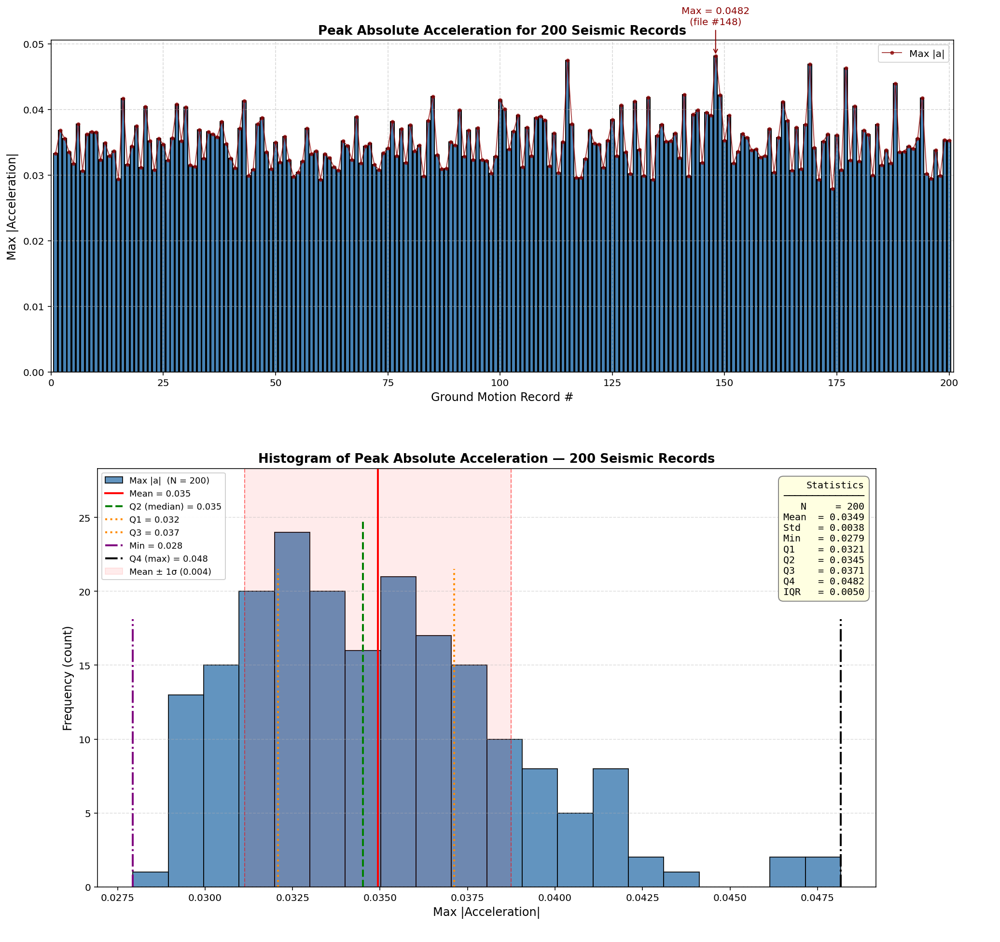

# PARAMETRIC NONLINEAR SEISMIC DEMAND SPECTRA OF A MULTI-DEGREE-OF-FREEDOM (MDOF) SYSTEMS WITH VARIABLE DUCTILITY CAPACITY
This OpenSees script performs a nonlinear MDOF ductility response-spectrum analysis
that characterizes an oscillator’s hysteretic behavior, energy dissipation, and
damage under earthquake excitation. It defines mass, stiffness, yield strength,
ultimate displacement, and damping; applies a cyclic displacement protocol to
establish baseline energy dissipation; then runs nonlinear time-history analyses
with Newmark integration over a parametric sweep of periods. For each period,
it extracts peak displacement, velocity, acceleration, and base reaction, and
computes the Ductility Damage Index, Energy Dissipation Capacity Index, and
Equivalent Viscous Damping Ratio. Finally, it statistically processes and plots
displacement, velocity, acceleration, base-reaction, DDI, EDCI, and EVDR spectra,
generates fragility information, and exports results for performance-based earthquake
engineering and parametric studies.

Since the structure was assumed to be inelastic and the response spectra were then plotted
for the energy dissipation capacity index and the ductility damage index, this shows the
natural period beyond which an increase in the structure’s period leads to a higher probability
of damage, and as the ductility ratio of the structure increases, the level of damage decreases.

طیف‌های تقاضای لرزه‌ای غیرخطی پارامتریک سیستم‌های چنددرجه‌آزادی با ظرفیت شکل‌پذیری متغیر در اوپنسیس


# MDOF Response Spectrum Analysis with Energy Dissipation Capacity Index (EDCI) & Equivalent Viscous Damping Ratio (EVDR)

**Nonlinear Dynamic Analysis of a 10-Story, 4-Column Multi-Degree-of-Freedom (MDOF) System in OpenSeesPy**  
**Seismic Response Spectra · Structural Ductility Damage Index · Energy Dissipation Capacity Index · Equivalent Viscous Damping Ratio**

---

## Overview

This repository provides a complete, modular **OpenSeesPy** framework for the nonlinear dynamic (time-history) analysis of a **10-story MDOF frame** (4 columns per floor) subjected to a suite of ground motions.

The primary objectives are:

1. Construction of **seismic response spectra** (peak displacement, velocity, acceleration, base shear, period, stiffness, etc.).
2. Evaluation of the **Structural Ductility Damage Index (DDI / DI)**.
3. Computation of the **Energy Dissipation Capacity Index (EDCI)**.
4. Evaluation of the **Equivalent Viscous Damping Ratio (EVDR / ξ_eq)**.
5. Supporting analyses: eigenvalue / free-vibration, Rayleigh damping, bilinear idealization, effective properties from pushover, and comprehensive post-processing (Excel export + publication-quality plots).

The framework is designed for **performance-based earthquake engineering (PBEE)** research and education. It systematically compares elastic vs. inelastic response, quantifies energy dissipation relative to cyclic capacity, and produces response spectra across multiple intensity measures.

> **Author**: Salar Delavar Ghashghaei (Qashqai)  
> **Email**: salar.d.ghashghaei@gmail.com  
> **License**: Educational / Research use (verify independently before engineering application)

---

## Structural Model

| Parameter                    | Value / Description                                      |
|-----------------------------|----------------------------------------------------------|
| Number of stories           | 10                                                       |
| Columns per floor           | 4                                                        |
| Degrees of Freedom          | Multi-degree-of-freedom (lateral springs + masses)       |
| Material modeling           | Elastic or inelastic (hysteretic material with pinching, strength/stiffness degradation) |
| Nonlinear constitutive law  | OpenSees `Hysteretic` (or equivalent) material with user-defined positive/negative backbone |
| Damping                     | Rayleigh damping (mass- and stiffness-proportional)      |
| Ground motions              | Suite of recorded / artificial accelerograms (extract from `.rar` archive) |

The model idealizes each story as a set of nonlinear lateral springs whose force-deformation backbone is defined by yield displacement \(D_y\), ultimate displacement \(D_u\) (or \(D_{SU}\)), yield force \(F_Y\), and ultimate force \(F_U\). Hardening ratio \(b = K_{sh}/K_e\) and plastic stiffness are computed automatically.

---

## Key Performance Metrics

### 1. Structural Ductility Damage Index (DDI / DI)

\[
DI = \frac{D_d - D_y}{D_u - D_y}
\]

- \(D_d\): peak dynamic displacement demand  
- \(D_y\): yield displacement  
- \(D_u\): ultimate displacement  

\(DI = 0\) indicates purely elastic response; \(DI \ge 1\) indicates that the ultimate capacity has been reached or exceeded.

### 2. Energy Dissipation Capacity Index (EDCI)

\[
EDCI = 100 \times \frac{E_d^{\text{earthquake}}}{E_d^{\text{cyclic}}}
\]

- \(E_d^{\text{earthquake}}\): hysteretic energy dissipated under the ground-motion record  
- \(E_d^{\text{cyclic}}\): energy dissipated under a controlled cyclic displacement protocol (reference capacity)

EDCI quantifies how effectively the structure utilizes its available hysteretic energy capacity during a real earthquake relative to a standardized cyclic test.

### 3. Equivalent Viscous Damping Ratio (EVDR)

\[
\xi_{eq} = 100 \times \frac{E_d}{4\pi E_s}
\]

- \(E_d\): dissipated energy of the hysteresis loop  
- \(E_s = \frac{1}{2} F_{\max} u_{\max}\): strain energy based on secant stiffness at maximum displacement

EVDR is a fundamental parameter for equivalent linearization and displacement-based design procedures.

---

## Analysis Workflow

The main driver script (`MDOF_RESPONSE_SPECTRUM_EDCI_EVDR.py`) orchestrates the following sequence:

1. **Model generation**  
   - Define nodes, masses, and nonlinear spring elements  
   - Assign hysteretic material properties (elastic or inelastic)

2. **Eigenvalue / Modal analysis**  
   - Compute natural periods and mode shapes  
   - Generate modal report (`SALAR_ModalReport_*.txt`)

3. **Rayleigh damping setup**  
   - Calibrate mass- and stiffness-proportional coefficients for target damping ratios

4. **Nonlinear time-history analysis**  
   - Apply each ground motion (scaled if required)  
   - Record displacement, velocity, acceleration, base reaction, element forces, and damage index at every time step

5. **Post-processing for each record**  
   - Peak absolute values of all response quantities  
   - Ductility Damage Index  
   - Energy Dissipation Capacity Index  
   - Equivalent Viscous Damping Ratio  
   - Effective period and stiffness

6. **Response spectrum construction**  
   - Aggregate results across the ground-motion suite  
   - Export multi-sheet Excel workbook and generate spectra plots

7. **Visualization & reporting**  
   - Time-history plots (displacement, base shear, hysteresis)  
   - Scatter plots (e.g., peak displacement vs. base reaction)  
   - Response spectra curves

---

## Directory Contents

| File / Folder                                      | Description                                                                 |
|----------------------------------------------------|-----------------------------------------------------------------------------|
| `MDOF_RESPONSE_SPECTRUM_EDCI_EVDR.py`               | **Main driver script** – complete analysis suite                            |
| `ANALYSIS_FUNCTION.py`                             | Core OpenSees analysis routines (time-history, free-vibration, etc.)        |
| `DAMAGE_INDEX_FUN.py`                              | Structural ductility damage index calculation                               |
| `EQULIVALENT_VISCOUS_DAMPING_RATIO_FUN.py`         | Equivalent viscous damping ratio (EVDR) computation                         |
| `BILINEAR_CURVE.py`                                | Bilinear idealization of backbone curves                                    |
| `COMPUTE_EFFECTIVE_PROPERTIES_FUN_PUSHOVER.py`     | Effective stiffness, yield strength, ductility from pushover                |
| `COMPUTE_EFFECTIVE_PROPERTIES_FUN_FREE_VIBRATION.py` | Effective properties from free-vibration analysis                         |
| `OPENSEEES_HYSTERETICSM_FORCE_DISP_FUN.py`         | Hysteretic material definition and force-displacement plotting              |
| `EIGENVALUE_ANALYSIS_FUN.py`                       | Modal analysis utilities                                                    |
| `RAYLEIGH_DAMPING_FUN.py`                          | Rayleigh damping coefficient calculation                                    |
| `DAMPING_RATIO_FUN.py`                             | Logarithmic-decrement damping estimation                                    |
| `200_SEISMIC_TIME_HISTORY.rar` (or similar)        | Archive of ground-motion time histories                                     |
| Output Excel files                                 | `INELASTIC_RESPONSE_SPECTRUM_SEISMIC_MDOF_RESULTS.xlsx`, `MDOF_RESPONSE_SPECTRUM_EDCI_EVDR_DATA_RESULTS.xlsx` |

---

# 200 SEISMIC GROUND MOTIONS ANALYSIS
  

## How to Run

### 1. Requirements

```bash
pip install openseespy numpy matplotlib pandas scipy openpyxl

unrar x 200_SEISMIC_TIME_HISTORY.rar

python MDOF_RESPONSE_SPECTRUM_EDCI_EVDR.py


