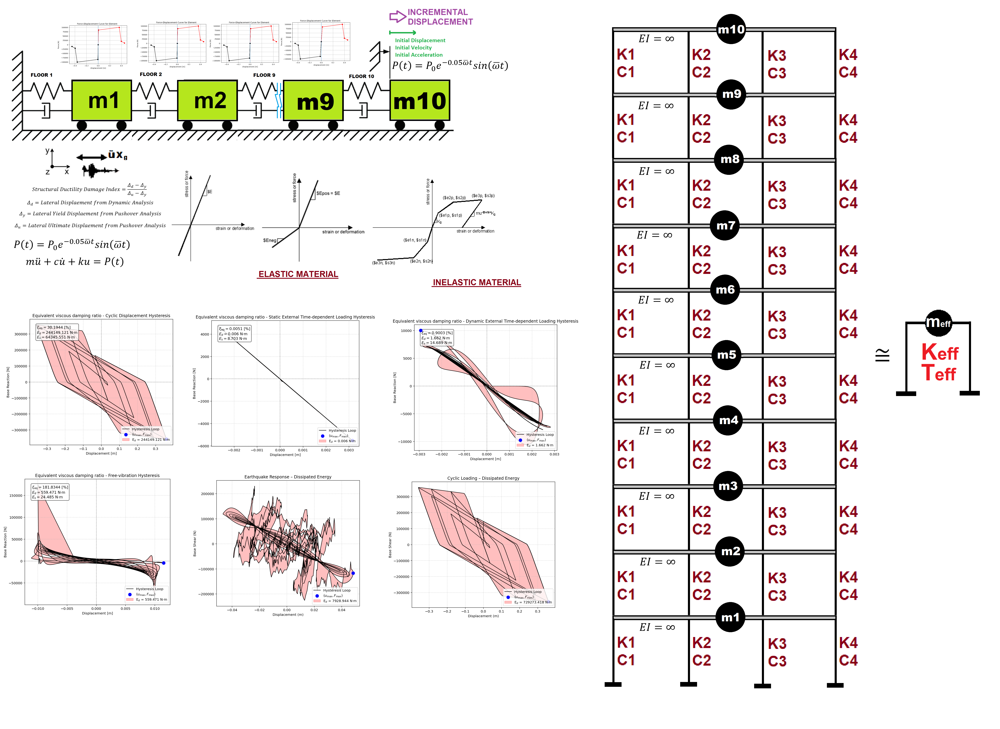
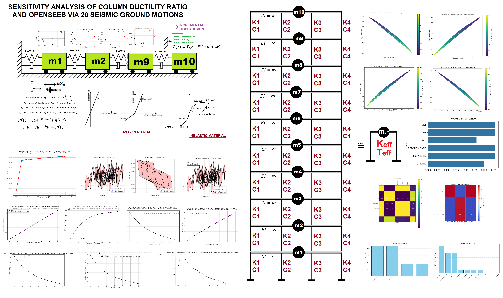
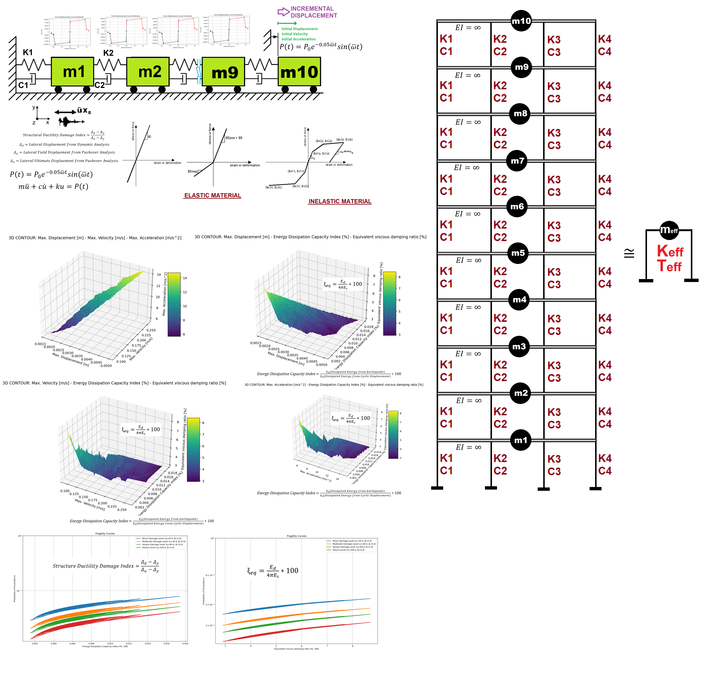
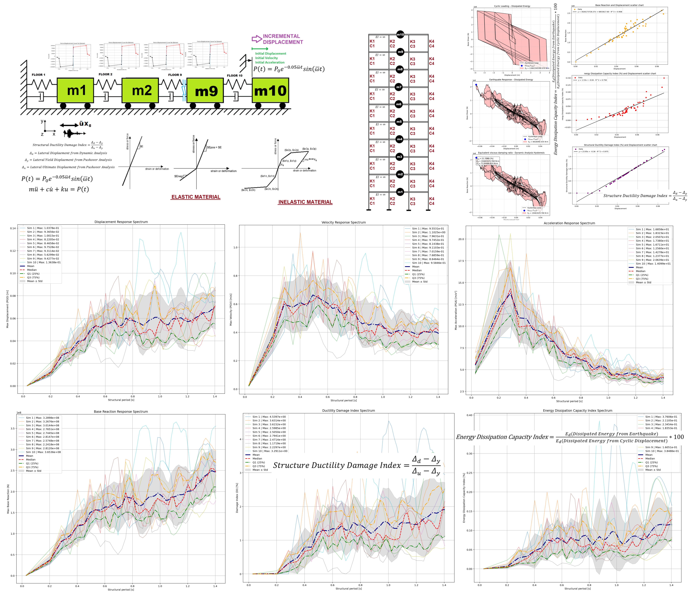
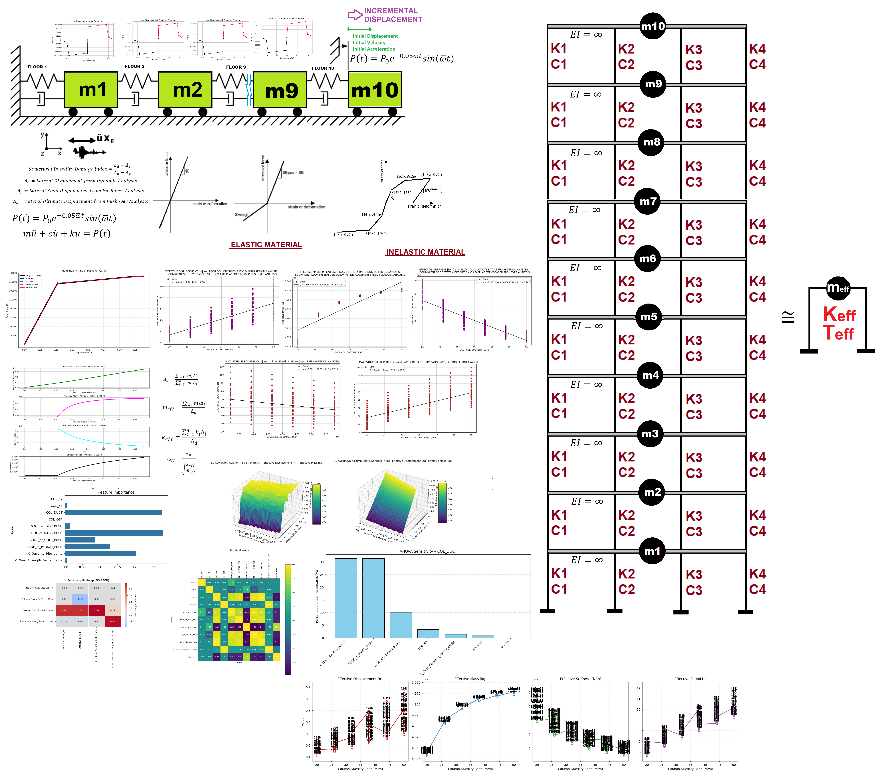
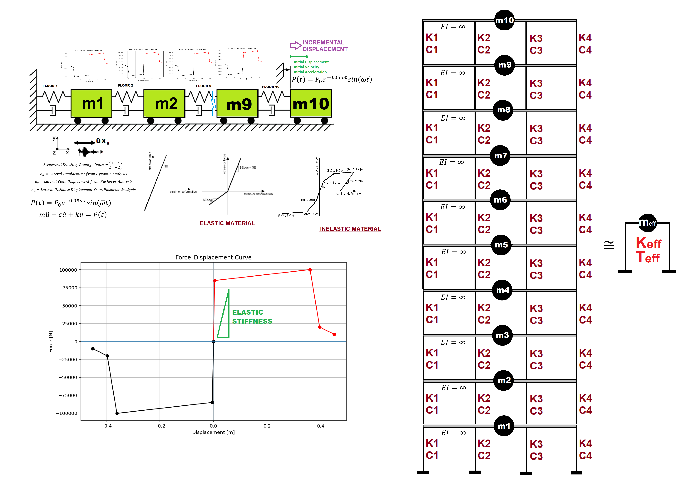
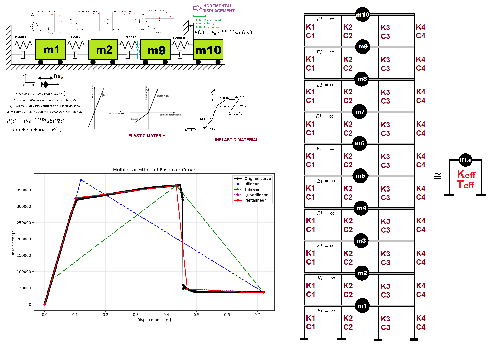

# +60_MDOF_10_FLOORS_04_COLUMNS_8_ANA
COMPREHENSIVE NONLINEAR SEISMIC ASSESSMENT OF A MULTI-DEGREE-FREEDOM (MDOF) STRUCTURE: AN OPENSEES FRAMEWORK FOR STATIC PUSHOVER, CYCLIC DEGRADATION, STATIC TIME-HISTORY AND DYNAMIC TIME-HISTORY ANALYSIS     

 

# DUCT_SENSITIVITY_20_SEISMIC_MDOF

 

# MDOF_200_SEISMIC_10_FLOORS_04_COLUMNS_EDCI_EVDR
FRAGILITY ANALYSIS BASED ON ACCELERATION, STRUCTURAL DUCTILITY DAMAGE INDEX, ENERGY DISSIPATION CAPACITY INDEX, EQULIVALENT VISCOUS DAMPING RATIO WITH NONLINEAR DYNAMIC ANALYSIS OF A MULTI-DEGREE-OF-FREEDOM (MDOF) SYSTEM UTILIZING 200 GROUND MOTIONS IN OPENSEES
     

# MDOF_DUCT_RESPONSE_SPECTRUM_EDCI_EVDR

# FY_KE_DUCT_OSF_SENSITIVITY_PUSHOVER_MDOF
SENSITIVITY ANALYSIS OF COLUMN YIELD STRENGTH, ELASTIC STIFFNESS, DUCTILITY RATIO, OVER-STRENGTH FACTOR AND OPENSEES VIA PUSHOVER ANALYSIS OF A MULTI-DEGREE-OF-FREEDOM STRUCTURE AND EVALUATION OF A MULTILINEAR FITTING CURVE FOR STRUCTURAL ELASTIC STIFFNESS, PLASTIC STIFFNESS, DUCTILITY RATIO, AND OVER-STRENGTH FACTOR

# OPTIMIZATION_PERIOD_MDOF_10_FLOORS_04_COLUMNS
DETERMINATION OF EACH COLUMN'S OPTIMUM STRUCTURAL INITIAL ELASTIC STIFFNESS FROM STRUCTURAL PERIOD (10 FLOORS, EACH FLOOR 4 COLUMNS) USING FINITE‑DIFFERENCE NEWTON ITERATION AND OPENSEES WITH AND WITHOUT PARALLEL COMPUTING

 

# PUSHOVER_MDOF_10_FLOORS_04_COLUMNS

# PUSHOVER_MDOF_10_FLOORS_04_COLUMNS_REVISED

This script builds a 10-story shear-building model in OpenSeesPy (one degree of freedom per floor, with four parallel columns per story, each modeled as a zero-length element with a HystereticSM material that has yield, peak, and two-stage strength-degrading branches) and uses it to compare two ways of reducing a multi-degree-of-freedom (MDOF) structure to an equivalent single-degree-of-freedom (SDOF) system. It first runs an eigenvalue analysis to get periods and the first mode shape, then performs a displacement-controlled pushover using a modal load pattern, tracking story-1 drift until the target is reached or convergence fails (with fallback algorithms at each step). From the resulting capacity curve, it applies the N2/ATC-40 transformation, which uses a fixed first-mode shape to compute the participation factor Γ, equivalent mass m*, and SDOF curve. It also applies a displacement-based design (DBD) approach, which uses the actual displaced shape at each step to compute effective displacement, mass, stiffness, and period. The SDOF curve is idealized as an equal-energy elastic-perfectly-plastic bilinear curve, truncated at 20% strength loss after the peak, from which yield point, ductility, and overstrength are extracted. A ductility-based damage index per story is computed from interstory drift. Finally, the script validates the SDOF idealization by running nonlinear time-history analyses on both the full MDOF model (with Rayleigh damping calibrated to modes 1 and 3) and the equivalent SDOF system under a synthetic band-limited ground motion, then compares the peak roof displacements (scaling the SDOF result by Γ) and plots the pushover curves, effective periods, displaced shapes, damage indices, story shears, and time histories.

