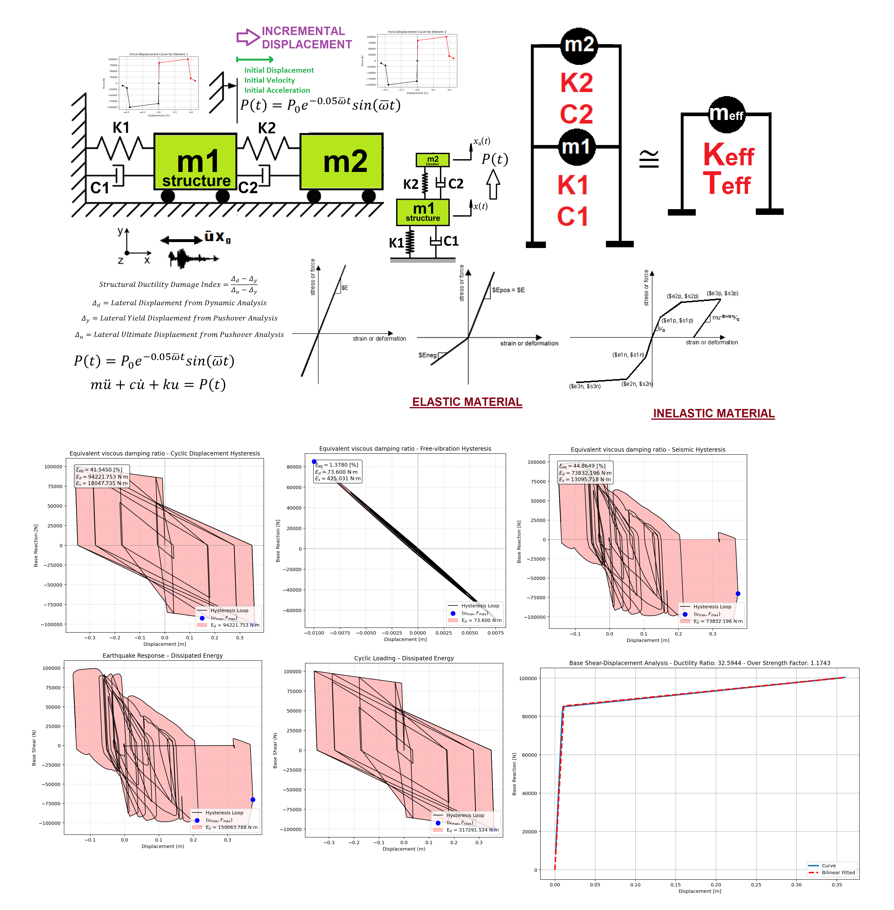
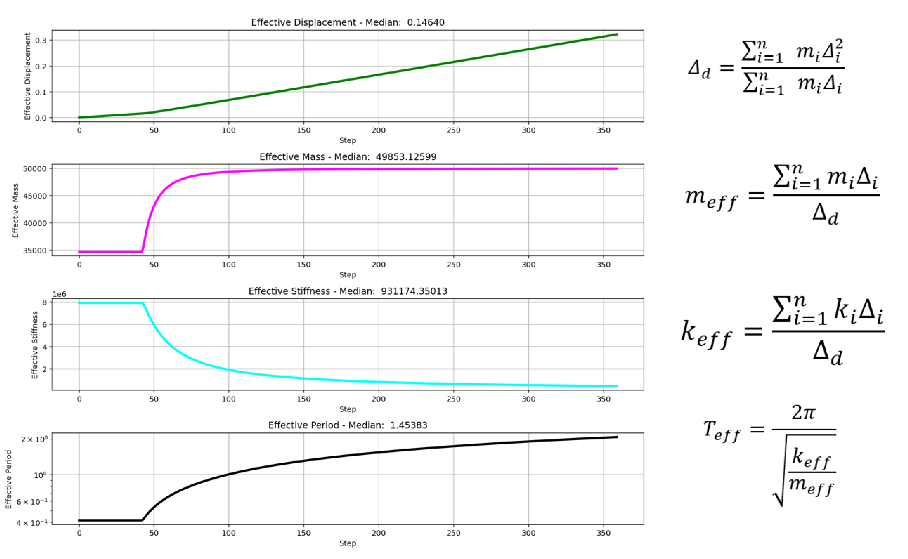

# COMPREHENSIVE NONLINEAR SEISMIC ASSESSMENT OF A MULTI-DEGREE-FREEDOM PENDULUM & STRUCTURE SYSTEM : AN OPENSEES FRAMEWORK FOR STATIC PUSHOVER, CYCLIC DEGRADATION, STATIC TIME-HISTORY AND DYNAMIC TIME-HISTORY ANALYSIS   

# ارزیابی جامع غیرخطی سازه چند درجه آزادی سازه و پاندول : چارچوبی مبتنی بر اوپنسیس در پایتون برای تحلیل پوش‌آور استاتیکی، تحلیل چرخه‌ای همراه با کاهش سختی، تحلیل تاریخچه زمانی استاتیکی و دینامیکی، با در نظر گرفتن شاخص‌های آسیب شکل‌پذیری در المان و سازه و ارزیابی شاخص ظرفیت انرژی اتلاف‌شده


 

# EQUIVALENT SDOF SYSTEM DERIVATION VIA DISPLACEMENT-BASED SEISMIC DESIGN PROCEDURE WITH PUSHOVER ANALYSIS


# +61_MDOF_PENDULUM_STRUCTURE_8_ANA

**Comprehensive Nonlinear Seismic Assessment of a Multi-Degree-of-Freedom (MDOF) Pendulum–Structure System**  
An OpenSeesPy Framework for Static Pushover, Cyclic Degradation, Static Time-History, Dynamic Time-History, Free-Vibration, and Modal Analysis  
with Evaluation of Ductility Damage Index (DDI), Energy Dissipation Capacity Index (EDCI), and Equivalent Viscous Damping Ratio (EVDR)

---

## Overview

This repository implements a high-fidelity nonlinear dynamic analysis framework for a coupled **MDOF structure + pendulum** system using **OpenSeesPy**. The model represents a primary multi-mass structure interacting with a secondary pendulum mass (tunable mass damper / vibration absorber idealization).

The code systematically executes **eight analysis protocols**, computes advanced performance metrics (DDI, EDCI, EVDR), derives equivalent SDOF properties via displacement-based design procedures, and generates extensive post-processing visualizations and reports.

**Author:** Salar Delavar Ghashghaei (Qashqai)  
**Email:** salar.d.ghashghaei@gmail.com  
**Framework:** OpenSeesPy + NumPy + Matplotlib

---

## Key Features

- **Coupled MDOF Pendulum–Structure System**
  - Primary structure mass distribution + secondary pendulum mass (typically 5 % of total mass)
  - Independent damping ratios for structure and pendulum
  - Zero-length spring elements with elastic or hysteretic (HystereticSM) material models

- **Eight Analysis Protocols**
  1. **PERIOD** – Eigenvalue analysis & modal properties
  2. **STATIC** – Gravity / dead-load analysis
  3. **PUSHOVER** – Displacement-controlled capacity curve & plastic mechanism identification
  4. **CYCLIC_DISPLACEMENT** – Symmetric cyclic protocol for full hysteresis, pinching, and energy dissipation capacity
  5. **STATIC_EXTERNAL_TIME-DEPENDENT_LOADING** – Static analysis under \( P(t) = P_0 \sin(\omega t) \) or damped harmonic loading
  6. **DYNAMIC_EXTERNAL_TIME-DEPENDENT_LOADING** – Dynamic analysis under the same external loads
  7. **FREE-VIBRATION** – Free vibration with initial conditions + logarithmic-decrement damping estimation
  8. **SEISMIC / DYNAMIC TIME-HISTORY** – Nonlinear time-history analysis under ground-motion records

- **Performance Metrics**
  - **Ductility Damage Index (DDI)**  
    \[
    DI = \frac{D_d - D_y}{D_u - D_y}
    \]
    where \( D_d \) = peak dynamic demand, \( D_y \) = yield displacement, \( D_u \) = ultimate displacement.
  - **Energy Dissipation Capacity Index (EDCI)**  
    \[
    EDCI = 100 \times \frac{E_d^{\text{earthquake}}}{E_d^{\text{cyclic}}}
    \]
  - **Equivalent Viscous Damping Ratio (EVDR)**  
    \[
    \xi_{eq} = 100 \times \frac{E_d}{4\pi E_s}
    \]

- **Equivalent SDOF Reduction**
  - Displacement-based seismic design procedure using pushover results
  - Effective modal mass, stiffness, period, and participation factors

- **Advanced Post-Processing**
  - Force–displacement hysteresis loops
  - Backbone curves & multilinear fitting
  - Time-history plots (displacement, velocity, acceleration, reaction, forces)
  - Modal period elongation due to inelasticity
  - Rayleigh damping implementation
  - Fragility-curve utilities
  - Comprehensive PDF and PowerPoint report generation

---

## Directory Contents

| File / Folder | Description |
|---------------|-------------|
| `P(t)_MDOF_PENDULUM_STRUCTURE_8_ANA.py` | **Main analysis script** |
| `ANALYSIS_FUNCTION.py` | Core analysis driver for the eight protocols |
| `DAMAGE_INDEX_FUN.py` | Ductility Damage Index computation |
| `EQULIVALENT_VISCOUS_DAMPING_RATIO_FUN.py` | EVDR calculation |
| `OPENSEEES_HYSTERETICSM_FORCE_DISP_FUN.py` | Hysteretic material definition & plotting |
| `BILINEAR_CURVE.py` | Bilinear / multilinear capacity curve fitting |
| `EIGENVALUE_ANALYSIS_FUN.py` | Modal analysis utilities |
| `RAYLEIGH_DAMPING_FUN.py` | Rayleigh damping coefficient calculation |
| `PERIOD_FUN.py` | Period extraction utilities |
| `DAMPING_RATIO_FUN.py` | Logarithmic-decrement damping ratio |
| `COMPUTE_EFFECTIVE_PROPERTIES_FUN.py` | Equivalent SDOF properties |
| `PLOT_1D_SPRING.py` / `PLOT_2D_TRUSS.py` | Visualization helpers |
| `Ground_Acceleration_X.txt` / `Ground_Acceleration_Y.txt` | Sample ground-motion records |
| `COVER.png`, `COVER_DISPLACEMENT_BASED.png` | Cover figures |
| `PDF_P(t)_MDOF_PENDULUM_STRUCTURE_8_ANA.pdf` | Generated report |
| `PPT_P(t)_MDOF_PENDULUM_STRUCTURE_8_ANA.pptx` | Presentation slides |
| Supporting math & utility modules (`SALAR_MATH.py`, etc.) |

---

## Model Idealization

- **Nodes:** Fixed base + structural masses + pendulum mass
- **Elements:** Zero-length springs (uniaxial) representing lateral stiffness of the structure and pendulum attachment
- **Materials:**
  - Elastic
  - HystereticSM (with pinching, degradation, and post-peak softening)
- **Masses:**  
  Structure ≈ 95 % of total mass, Pendulum ≈ 5 % of total mass (adjustable)
- **Damping:** Independent Rayleigh or viscous damping ratios for structure and pendulum

---

## How to Run

```bash
# Recommended environment
pip install openseespy numpy matplotlib

# Execute main script
python P(t)_MDOF_PENDULUM_STRUCTURE_8_ANA.py
