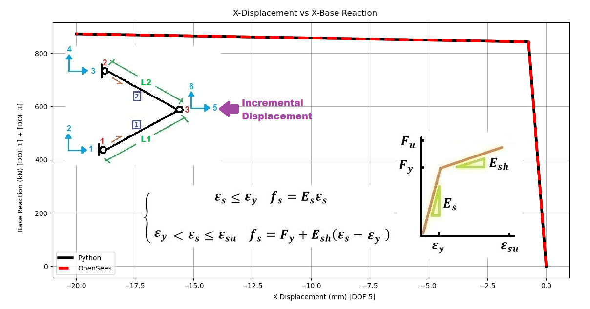

# PUSHOVER ANALYSIS OF TRUSS SUBJECTED TO LATERAL DISPLACEMENT MATERIAL AND GEOMETRIC NONLINEARITIES EFFECT CHECKING THE ANALYSIS BY DISPLACEMENT CONTROL VERIFIED BY OPENSEES 

# تحلیل پوش‌اور خرپا تحت جابجایی جانبی با در نظر گرفتن اثر غیرخطی‌های مصالح و هندسی و صحت‌سنجی نتایج با روش کنترل جابجایی در OpenSees
 

THIS PYTHON SCRIPT IS WRITTEN BY SALAR DELAVAR GHASHGHAEI (QASHQAI)
