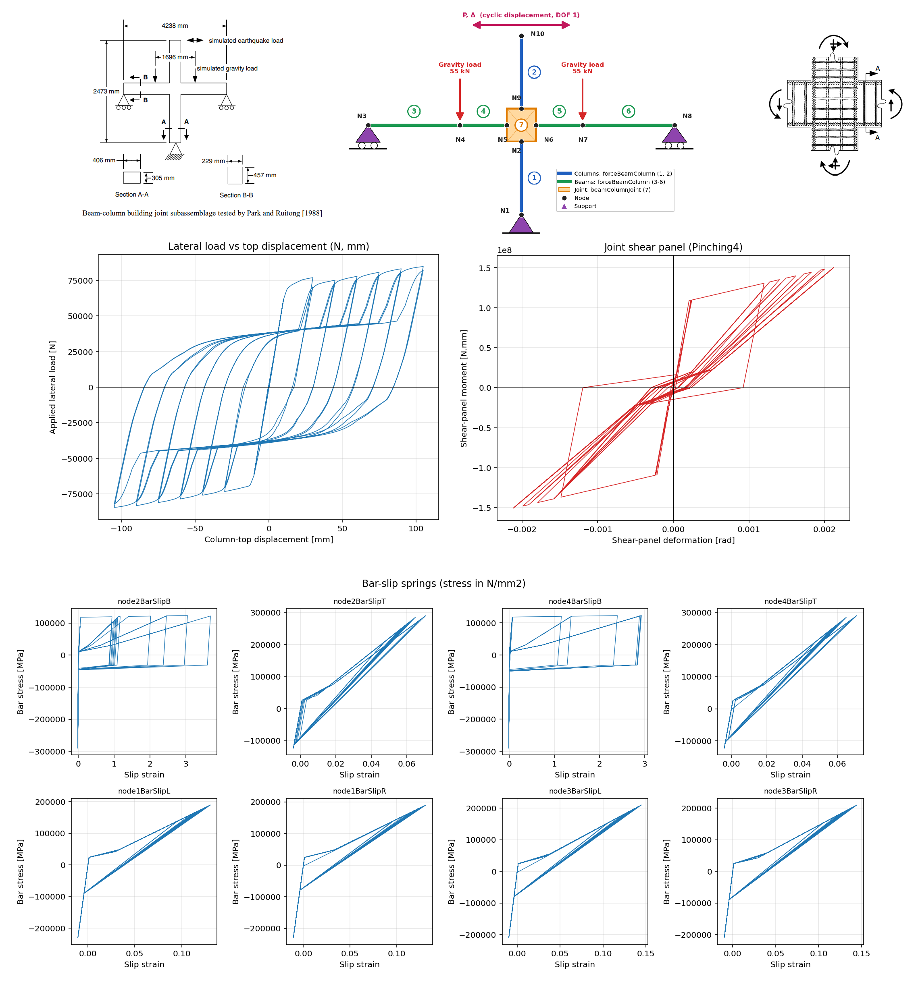

# NONLINEAR CYCLIC ANALYSIS OF A REINFORCED CONCRETE BEAM-COLUMN JOINT SUB-ASSEMBLAGE USING OPENSEESPY
# تحلیل غیرخطی چرخه‌ای یک زیرمجموعه اتصال تیر-ستون بتن مسلح با استفاده از OpenSeesPy

This script is an OpenSeesPy version of the OpenSees wiki example BeamColumnJointExample (https://opensees.berkeley.edu/wiki/index.php/BeamColumnJointExample). The original is written in Tcl as `PR1.tcl`, `procMKPC.tcl`, `procUniaxialPinching.tcl` and `procRC.tcl`. The example models a reinforced-concrete beam-column cruciform. The wiki describes it as carrying constant gravity load at nodes 4 and 7 and cyclic lateral displacement control at node 10. The beams and columns are fiber-based nonlinear elements (elements 1–6), and the joint (element 7) is a `beamColumnJoint` element with 13 components, 9 of which use the Pinching4 material. In the script, `MKPC_FUN` computes the confined-concrete properties with the Modified Kent–Park model. It converts to psi and inches internally and returns MPa and mm/mm. `FUN_uniaxial_pinching` wraps the `Pinching4` command, which is used for the joint shear panel. `MODEL_FUN` builds the whole model in N, mm and MPa. This includes the nodes, the concrete and steel materials, the column and beam fiber sections, the force-based elements, the 8 bar-slip materials, the shear-panel material and the supports. The code references the PEER report by Lowes, Mitra and Altoontash and Mitra's PhD thesis as the theory behind the joint element.

The second part of `MODEL_FUN` runs the analysis. It applies the gravity pattern, but the load increment `GRAVITY_DLAMBDA` is 0.0, so the 55 kN loads are never actually applied, exactly as in the Tcl. It then adds a unit lateral load at node 10 and drives the column top through the reversed-cyclic displacement history in `peakpts`, using displacement control. If a step fails, it tries KrylovNewton, NewtonLineSearch and Newton in turn, and uses ArcLength only as a last resort. All fallbacks use the same tolerance of 1e-6 with 500 iterations, so the `tol` values in the list are unused. `new_record`, `record_step` and `save_record` store the load, displacement, shear-panel and bar-slip histories and write them to `.txt` files. `PLOTS_FUN` saves and shows the load–displacement, shear-panel and bar-slip plots in N and mm, and `main()` reads the command-line options and runs everything.

