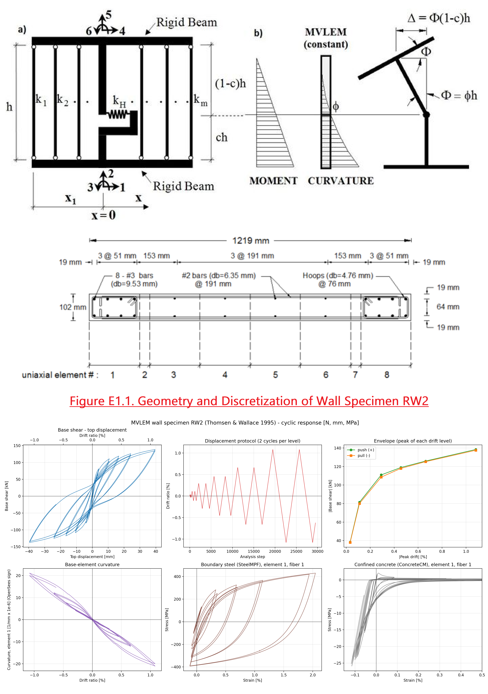

# CYCLIC ANALYSIS OF CONCRETE SHEAR-WALL USING MVLEM ELEMENT IN OPENSEESPY 
# تحلیل چرخه‌ای دیوار بتن‌آرمه RW2 با استفاده از مدل MVLEM در OpenSeesPy

This script simulates a real RC wall test (specimen RW2, Thomsen & Wallace, 1995) in OpenSeesPy. The wall is 3657.6 mm tall and 101.6 mm thick, and it is modeled with 16 stacked MVLEM elements, each made of 8 vertical fibers with steel, confined concrete and unconfined concrete materials. First, it applies a constant axial load of about 378 kN at the top. Then it pushes and pulls the top of the wall sideways, in small displacement steps, through eight drift levels (up to about 2%), with two full cycles at each level. If a step fails to converge, the solver switches to backup methods. At every step the code records the top displacement, base shear, base curvature, and the stress and strain of a boundary fiber. At the end it plots the hysteresis loops, the loading protocol, the peak envelope, the curvature, and the steel and concrete stress-strain curves.

 A short version of the source sentence, if you want it separate: “The model data were taken from the OpenSees MVLEM wiki example (Kolozvari, 2015, Tcl) and converted to OpenSeesPy in N-mm-MPa units.”
 
ORIGINAL TCL EXAMPLE: MVLEM - Multiple-Vertical-Line-Element-Model for RC Walls: 

https://opensees.berkeley.edu/wiki/index.php/MVLEM_-_Multiple-Vertical-Line-Element-Model_for_RC_Walls 

