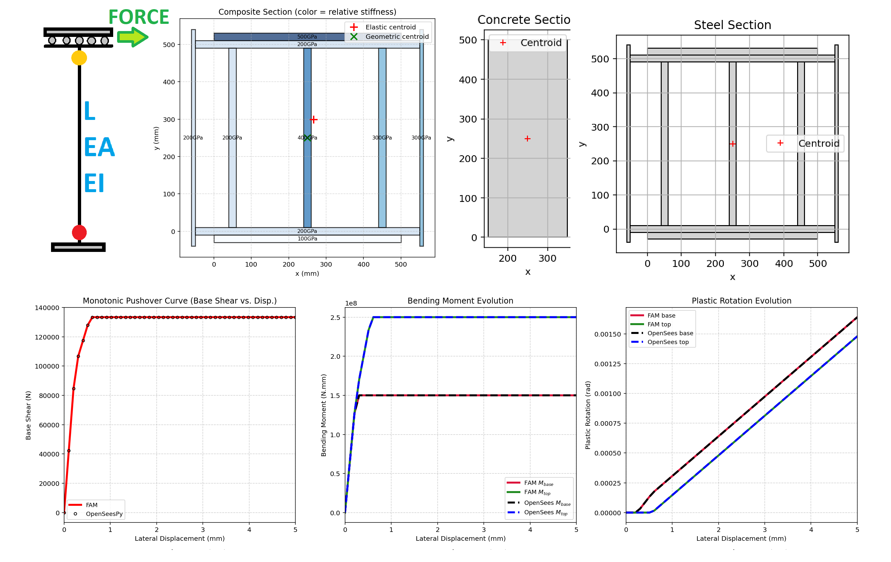
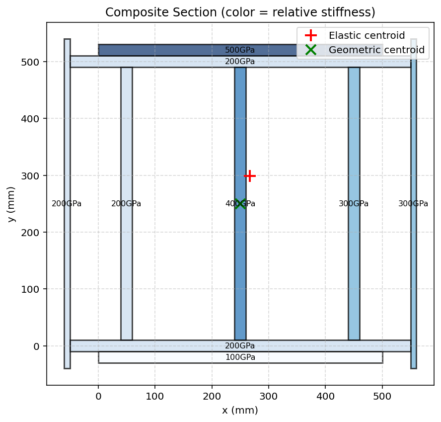
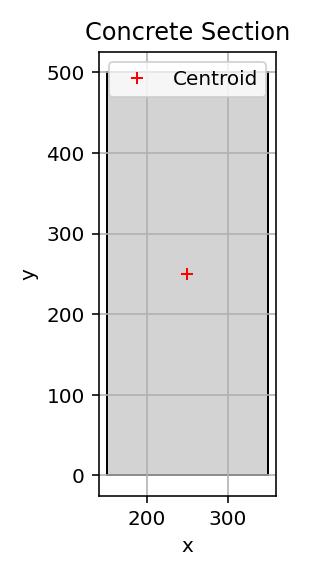
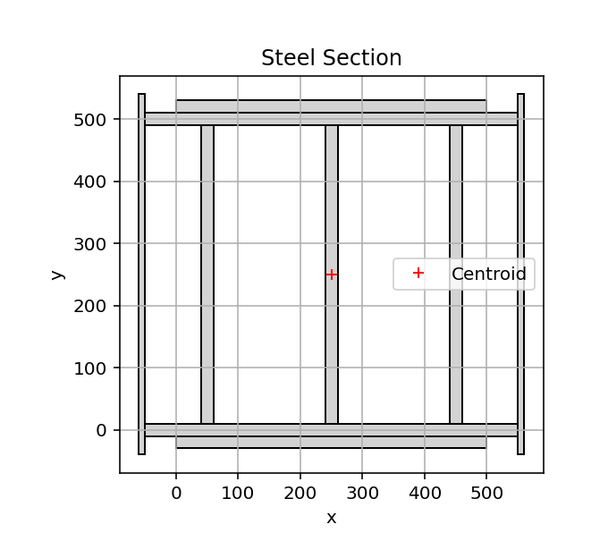

# MONOTONIC PUSHOVER ANALYSIS OF STRUCTURE WITH FORCE ANALOGY METHOD (FAM) AND OPENSEESPY VERIFICATION
# تحلیل پوش‌اور یکنواخت سازه با روش آنالوژی نیرو و صحت‌سنجی با اوپنسیس

This Python script performs a monotonic pushover analysis of a fixed-guided column (antisymmetric double-curvature behavior) using the Force Analogy Method (FAM) from earthquake engineering literature and verifies the results against an equivalent OpenSeesPy finite-element model. It first obtains transformed composite-section properties (area, moments of inertia, and reference modulus), then analytically evaluates the FAM solution by testing admissible plastic-hinge sequences (none, base only, top only, or both) to compute base shear, end moments, and plastic rotations under increasing lateral displacement. The OpenSeesPy counterpart models the member with an elastic beam-column element whose stiffness is adjusted via the Ibarra–Medina–Krawinkler factor together with two concentrated zero-length rotational springs (Steel01 materials) that capture elastic-perfectly plastic hinge behavior; a displacement-controlled static analysis is run and the resulting base shear, moments, and plastic rotations are recorded. Finally the script prints a quantitative error summary comparing the two methods and generates three comparison plots of the pushover curve, moment evolution, and plastic-rotation evolution.

# COMPOSITE_ELASTIC_SECTION_ANALYSIS_FUN

# CONCRETE_ELASTIC_SECTION_ANALYSIS_FUN

# STEEL_ELASTIC_SECTION_ANALYSIS_FUN

