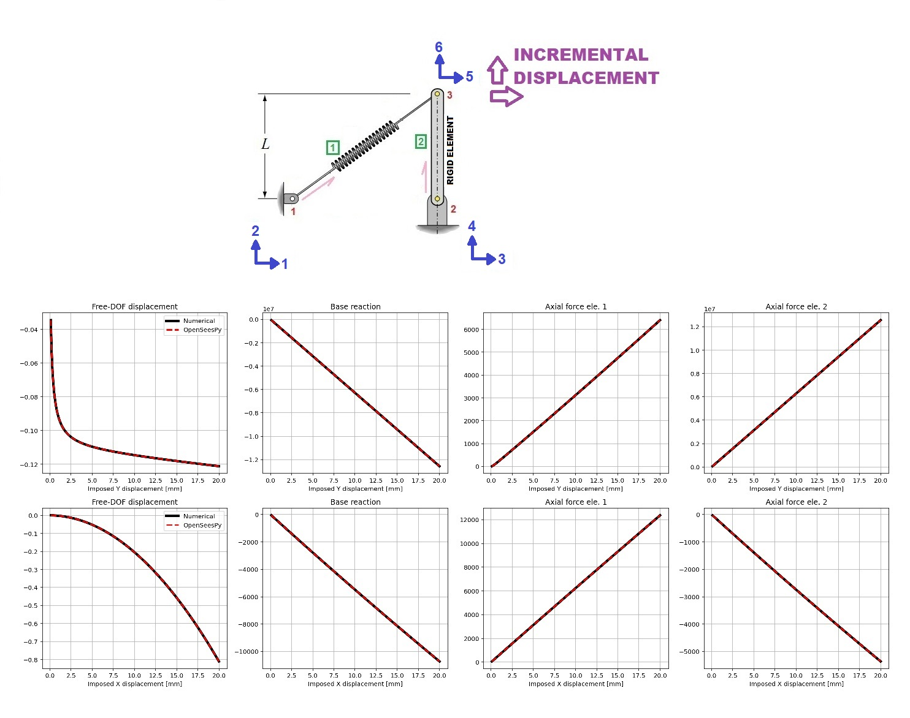

# LARGE-DISPLACEMENT MONOTONIC PUSHOVER OF A 2-BAR TRUSS: NUMERICAL NEWTON-RAPHSON METHOD WITH OPENSEESPY VERIFICATION

# پوش‌اور یکنواخت با جابجایی بزرگ خرپای دو عضوی: روش عددی نیوتن-رافسون و صحت‌سنجی با OpenSeesPy
This script verifies a large-displacement two-bar truss pushover by solving it two independent ways and comparing them. The model has two pinned supports (nodes 1 and 2) and one free node 3 at (500, 250), connected by a flexible diagonal bar (element 1) and a very stiff vertical bar (element 2), with parameters taken from your original example. TRUSS_INTERNAL takes node 3’s displacement and computes, for each bar, its current length, unit direction and axial force N = EA·(L−L0)/L0. It sums these into the internal force vector and builds the consistent tangent matrix: the material part (EA/L0)·e·eᵀ plus the geometric part (N/L)·(I − e·eᵀ), which captures how bar rotation changes stiffness. TRUSS_NUMERICAL uses that function for a displacement-controlled Newton–Raphson: at each 1 mm increment it imposes the displacement on one DOF (Y for case ‘Y’, X for case ‘X’), then iterates on the other, free DOF until its force residual is zero, since no external load acts there. It stores the node displacements, the base reaction (−f in the imposed direction) and the two axial forces. TRUSS_OPENSEES builds the same structure with two corotTruss elements, an Elastic material, a unit reference load along the imposed DOF, and the DisplacementControl integrator with Newton iterations. It falls back to your ANALYSIS() helper if an increment fails, then records the same five quantities from node displacements, reactions and basicForce. The main block runs both methods for each case, prints the maximum relative error for every quantity, and plots them in a 2×4 grid, with the numerical result as a thick black line and OpenSees as a red dashed line, so overlapping curves confirm the two methods agree.

