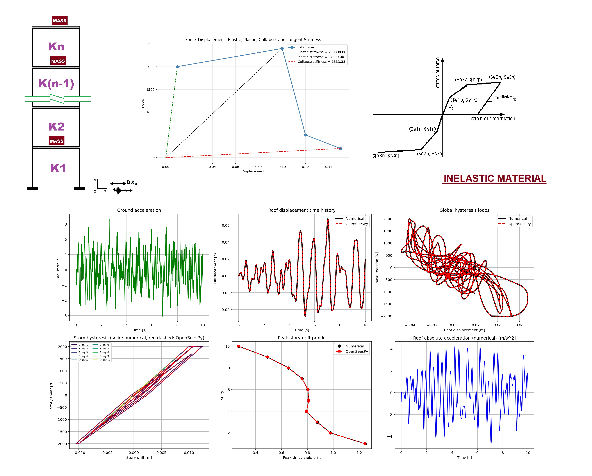

# NONLINEAR DYNAMIC (TIME-HISTORY) ANALYSIS OF A MULTI-STORY NONLINEAR SHEAR BUILDING (FINITE ELEMENT METHOD IN PYTHON AND OPENSEESPY VERIFICATIONS)

# تحلیل دینامیکی غیرخطی (تاریخچه زمانی) یک ساختمان برشی غیرخطی چند طبقه (روش اجزای محدود در پایتون و صحت‌سنجی با OpenSeesPy)

This Python script performs nonlinear dynamic time-history analysis of an N-story shear building whose stories are modeled as peak-oriented hysteretic springs acting on inter-story drifts. It assembles the initial elastic stiffness and mass matrices, computes modal properties and Rayleigh damping coefficients calibrated to a target damping ratio in two selected modes, and integrates the equations of motion with the average-acceleration Newmark-β method combined with full Newton-Raphson iteration at every time step; an equivalent OpenSeesPy model that uses zero-length elements with HystereticSM materials, the same Rayleigh damping, UniformExcitation, and Newmark integrator is run for verification. After loading a ground-acceleration record, scaling the floor masses to achieve a prescribed fundamental period, and executing both solvers, the script reports peak responses, displacement and force errors between the two implementations, and generates diagnostic plots of ground motion, roof displacement histories, global and story-level hysteresis loops, peak-drift profiles, and absolute roof acceleration.

# FLOWCHART DOCUMENT: PDF_MDOF_DYNAMIC_TIME_HISTORY_Flowcharts.pdf

