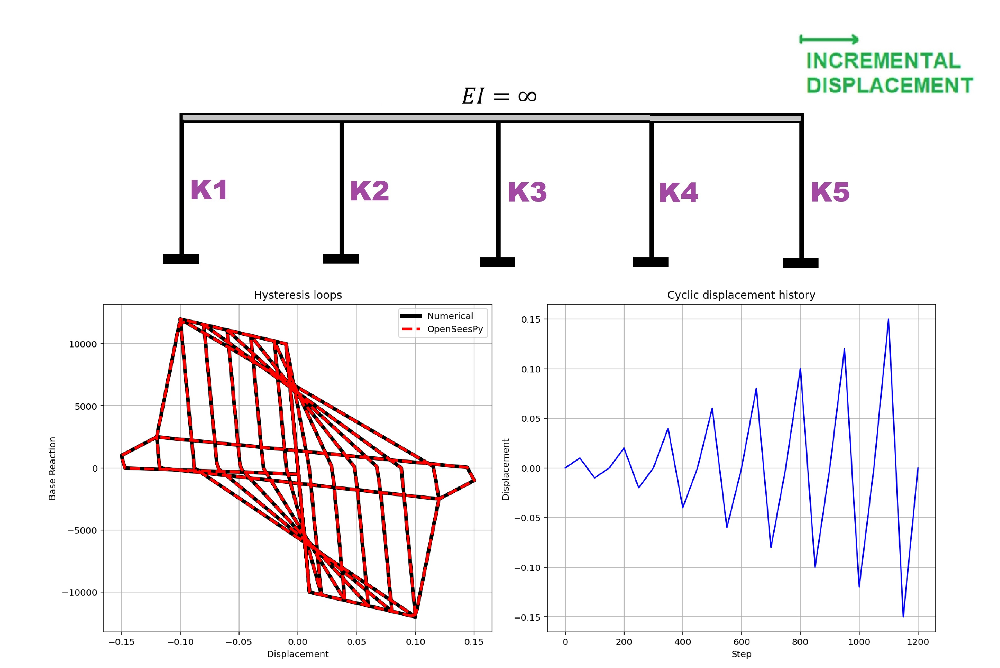

# CYCLIC DISPLACEMENT-CONTROLLED NEWTON-RAPHSON PUSHOVER OF A PARALLEL NONLINEAR SDOF SPRING (FINITE ELEMENT METHOD IN PYTHON AND OPENSEESPY VERIFICATIONS)
# تحلیل پوش‌اور چرخه‌ای با کنترل تغییرمکان به روش نیوتن-رافسون برای فنر غیرخطی موازی یک‌درجه‌آزادی (روش اجزای محدود در پایتون و راستی‌آزمایی با OpenSeesPy)

This python script drives the same parallel-spring SDOF system through a back-and-forth displacement history (0 → +a → −a → 0 at growing amplitudes) using two independent approaches and compares them. DISP_HISTORY builds the list of target displacements step by step. The numerical solver SDOF_NUMERICAL_CYCLIC_NEWTON works like the monotonic version (predict with the last tangent, compute the residual, correct the force until balanced), but because force now depends on loading history, the SPRING function remembers the last reversal point and the largest peaks on each side. It then decides the branch: follow the backbone when pushing past the previous peak, unload along the initial stiffness after a reversal, or reload in a straight line toward the previous peak on the opposite side. SDOF_OPENSEES_CYCLIC builds the equivalent model with HystereticSM springs and re-issues the DisplacementControl increment at every step so the node lands exactly on each target displacement. Finally, the main block runs both, prints the maximum absolute and relative error, and plots the two hysteresis loops together with the displacement history, so you can check that the hand-written hysteresis rule reproduces OpenSees.

This example is recommended for friends interested in learning the basics of nonlinear finite element methods.

