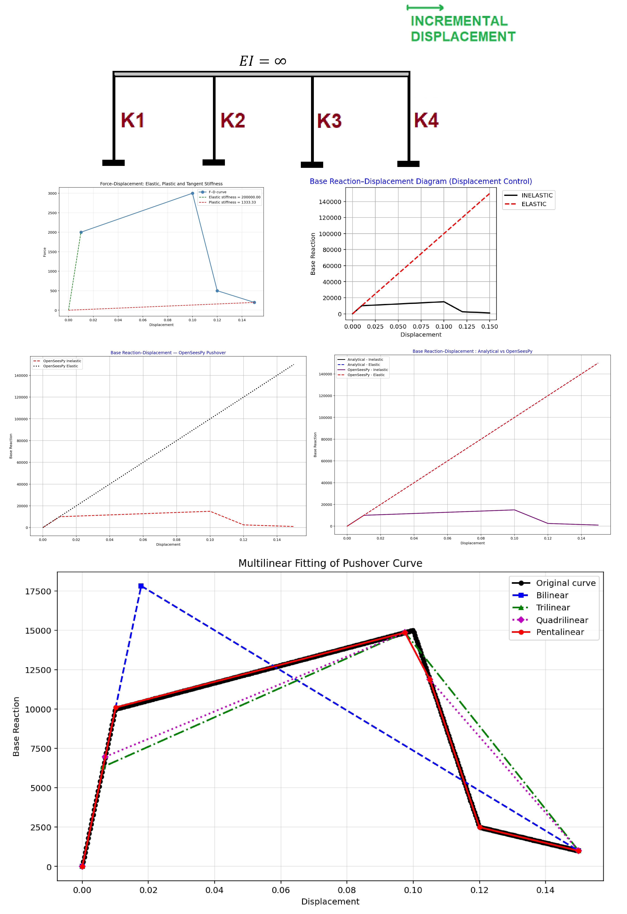

# MONOTONIC PUSHOVER ANALYSIS OF A SINGLE-DEGREE-OF-FREEDOM (SDOF) NONLINEAR SPRING WITH DISPLACEMENT CONTROL (FINITE ELEMENT METHOD IN PYTHON AND OPENSEESPY VERIFICATIONS)

# تحلیل پوش‌اور یکنواخت یک سیستم فنر غیرخطی یک‌درجه آزادی (SDOF) با کنترل جابه‌جایی (روش المان محدود در پایتون و صحت‌سنجی با OpenSeesPy)

This script performs a displacement-controlled monotonic pushover analysis of a single-degree-of-freedom (SDOF) system made of parallel nonlinear springs, first analytically in Python and then using OpenSeesPy for verification. It defines a multilinear force–displacement backbone (`Force` and `Displacement`) and per-spring coefficients (`Coff`), computes segment stiffnesses, and steps the imposed displacement up to the maximum specified displacement; at each step it calculates each spring’s tangent stiffness and force, sums them to obtain the total base reaction, and also constructs a linear-elastic comparison curve. It then plots residual–increment, iteration–increment, and base reaction–displacement diagrams. After that, it builds the same SDOF model in OpenSeesPy using `zeroLength` spring elements with either `HystereticSM` (inelastic multilinear) or `Elastic` materials, applies `DisplacementControl`, runs the pushover, and compares OpenSeesPy results with the analytical solution, reporting maximum absolute and relative errors. Finally, it post-processes the OpenSeesPy pushover curve by fitting area-preserving bilinear, trilinear, quadrilinear, and pentalinear approximations and reports elastic/plastic/tangent stiffness, ductility ratio, and overstrength factor.

