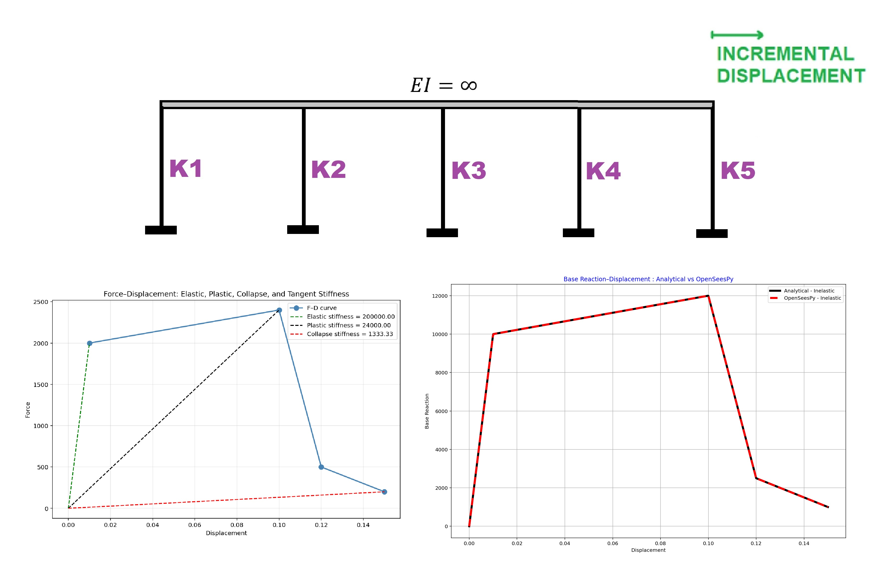

# DISPLACEMENT-CONTROLLED NEWTON-RAPHSON MONOTONIC PUSHOVER OF PARALLEL NONLINEAR SPRINGS (FINITE ELEMENT METHOD IN PYTHON AND OPENSEESPY VERIFICATIONS)
# تحلیل پوش‌اور یکنواخت یک سیستم فنر غیرخطی یک‌درجه آزادی (SDOF) با کنترل جابه‌جایی (روش المان محدود در پایتون و صحت‌سنجی با OpenSeesPy)
FILE NAME: SDOF_NEWTON_METHOD.py

This Python script implements and verifies a displacement-controlled Newton-Raphson monotonic pushover analysis of a single-degree-of-freedom system composed of parallel nonlinear springs. It defines a custom numerical solver (`SDOF_NUMERICAL_PUSHOVER_NEWTON`) that applies incremental displacements, predicts the load factor from the current tangent stiffness, updates internal forces from a multilinear backbone curve scaled by coefficients `Coff`, and applies a single-step Newton corrector (which simplifies to adjusting the load factor by the residual) until equilibrium is satisfied within a tight tolerance. The same problem is then solved with OpenSeesPy using zeroLength elements and HystereticSM (or Elastic) materials under DisplacementControl, after which the resulting force-displacement curves from both approaches are compared for accuracy, residual statistics are reported, and the curves are plotted.

# MONOTONIC PUSHOVER ANALYSIS OF A SINGLE-DEGREE-OF-FREEDOM (SDOF) NONLINEAR SPRINGS WITH DISPLACEMENT CONTROL (FINITE ELEMENT METHOD IN PYTHON AND OPENSEESPY VERIFICATIONS)

FILE NAME: SDOF_DC.py

This script performs a displacement-controlled monotonic pushover analysis of a single-degree-of-freedom (SDOF) system made of parallel nonlinear springs, first analytically in Python and then using OpenSeesPy for verification. It defines a multilinear force–displacement backbone (`Force` and `Displacement`) and per-spring coefficients (`Coff`), computes segment stiffnesses, and steps the imposed displacement up to the maximum specified displacement; at each step it calculates each spring’s tangent stiffness and force, sums them to obtain the total base reaction, and also constructs a linear-elastic comparison curve. It then plots residual–increment, iteration–increment, and base reaction–displacement diagrams. After that, it builds the same SDOF model in OpenSeesPy using `zeroLength` spring elements with either `HystereticSM` (inelastic multilinear) or `Elastic` materials, applies `DisplacementControl`, runs the pushover, and compares OpenSeesPy results with the analytical solution, reporting maximum absolute and relative errors. Finally, it post-processes the OpenSeesPy pushover curve by fitting area-preserving bilinear, trilinear, quadrilinear, and pentalinear approximations and reports elastic/plastic/tangent stiffness, ductility ratio, and overstrength factor.

This example is recommended for friends interested in learning the basics of nonlinear finite element methods.

