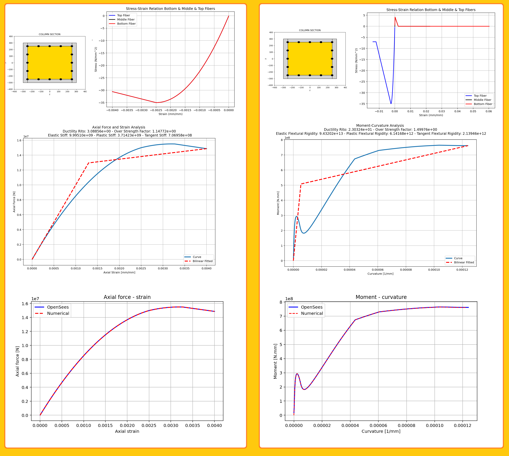

# CONFINED CONCRETE FIBER-SECTION ANALYSIS: AXIAL FORCE–STRAIN AND MOMENT–CURVATURE RESPONSE WITH OPENSEESPY VALIDATION

This code performs nonlinear fiber-section analysis of confined reinforced-concrete columns and beams (units N, mm) to obtain axial force–strain and moment–curvature responses under constant axial load. It first builds a detailed OpenSeesPy fiber model (core Concrete02, cover Concrete02, and steel rebars) for a rectangular section, applies displacement-controlled incremental analysis up to a prescribed ultimate strain or ductility ratio, records section forces/strains together with top/middle/bottom fiber stress–strain histories, fits a bilinear idealization to extract elastic/plastic stiffness, ductility and over-strength, and exports the results to Excel; a second, independent pure-NumPy implementation of the same fiber mesh and material envelopes then solves the axial equilibrium problem at each curvature (or axial strain) by root-finding, reproduces the OpenSeesPy curves, and quantifies the relative error, thereby providing both a practical structural-analysis tool and a transparent numerical verification of the confined-concrete section behavior.

