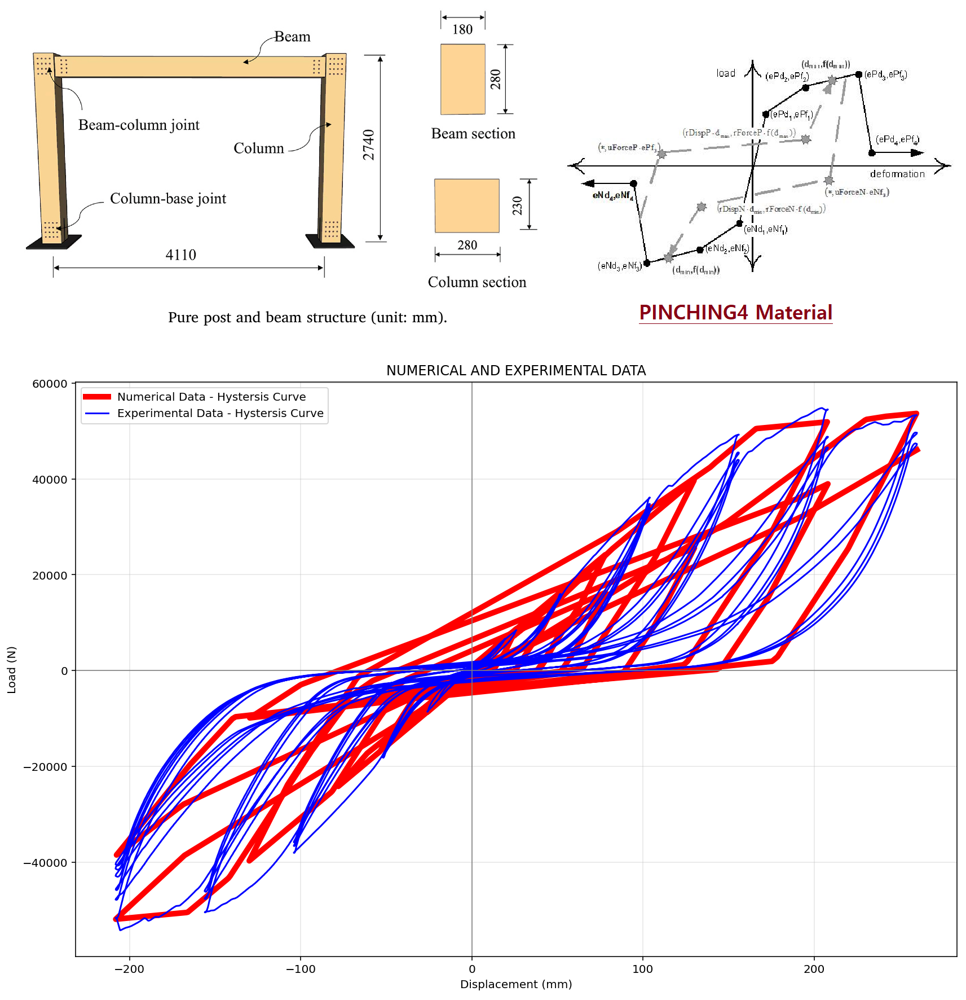

# NONLINEAR HYSTERSIS ANALYSIS OF A ONE-BAY, ONE-STORY TIMBER FRAME WITH SEMI-RIGID AND RIGID CONNECTIONS IN OPENSEES

#  تحلیل جابجایی چرخه ای غیرخطی یک قاب چوبی یک‌دهانه و یک‌طبقه با اتصالات نیمه‌صلب و صلب در نرم‌افزار اوپنسیس

This OpenSeesPy script performs a nonlinear static cyclic (hysteresis) analysis of a one-bay, one-story timber frame with semi-rigid or rigid beam-to-column connections. It builds a 2-D frame model whose elastic timber columns and beams are connected by zero-length elements whose rotational behavior is governed by calibrated Pinching4 materials (representing the hysteretic pinching, strength/stiffness degradation of the joints and base connections). After an initial dummy static analysis, a displacement-controlled cyclic protocol is applied at the roof node; roof displacement and base reactions are recorded, and the resulting numerical hysteresis curve is plotted against experimental data extracted from an Excel file, together with a visualization of the deformed frame.
 
All information has been extracted from the article:
Seismic performance of glulam timber post and beam structures with and without light frame timber shear wall infill
'https://www.sciencedirect.com/science/article/abs/pii/S2352710222009767'

Special thanks to Kashif Salman, Ph.D. for his valuable cooperation.
 

