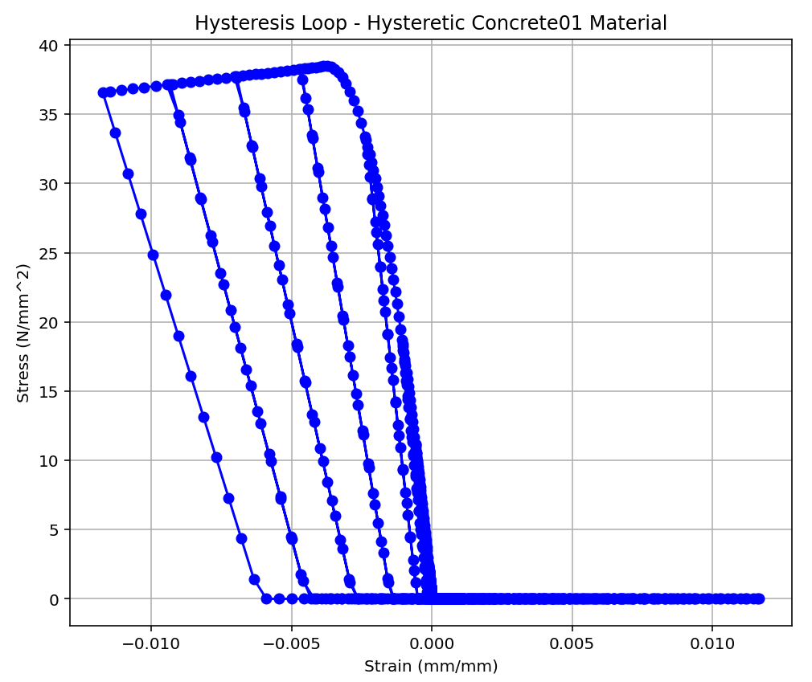
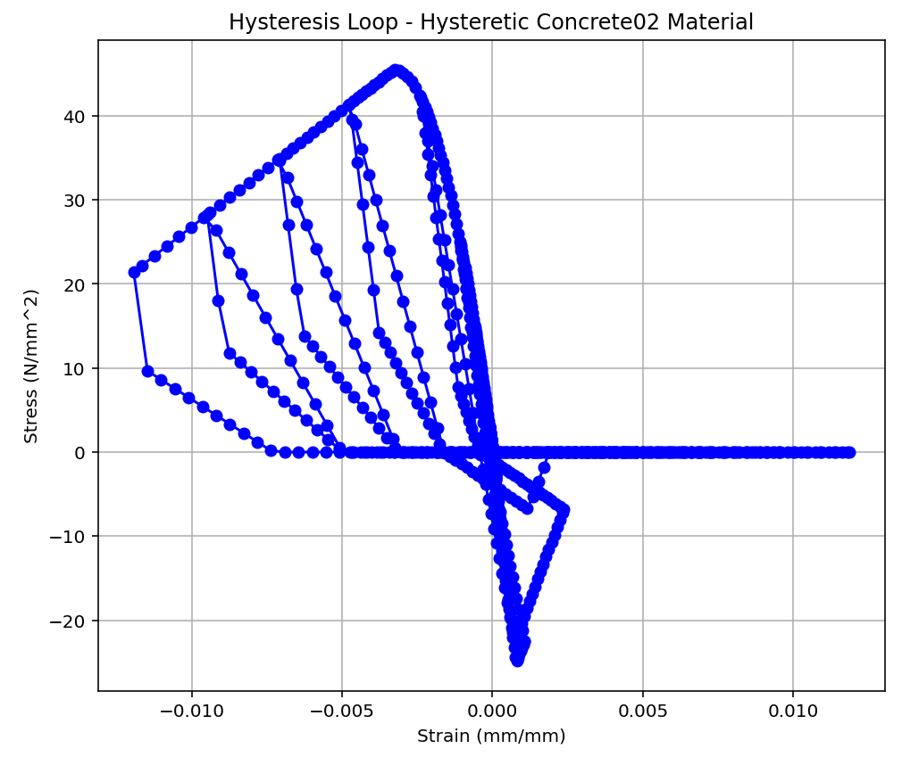
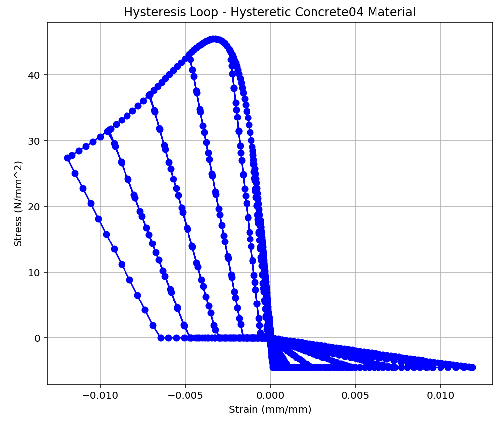
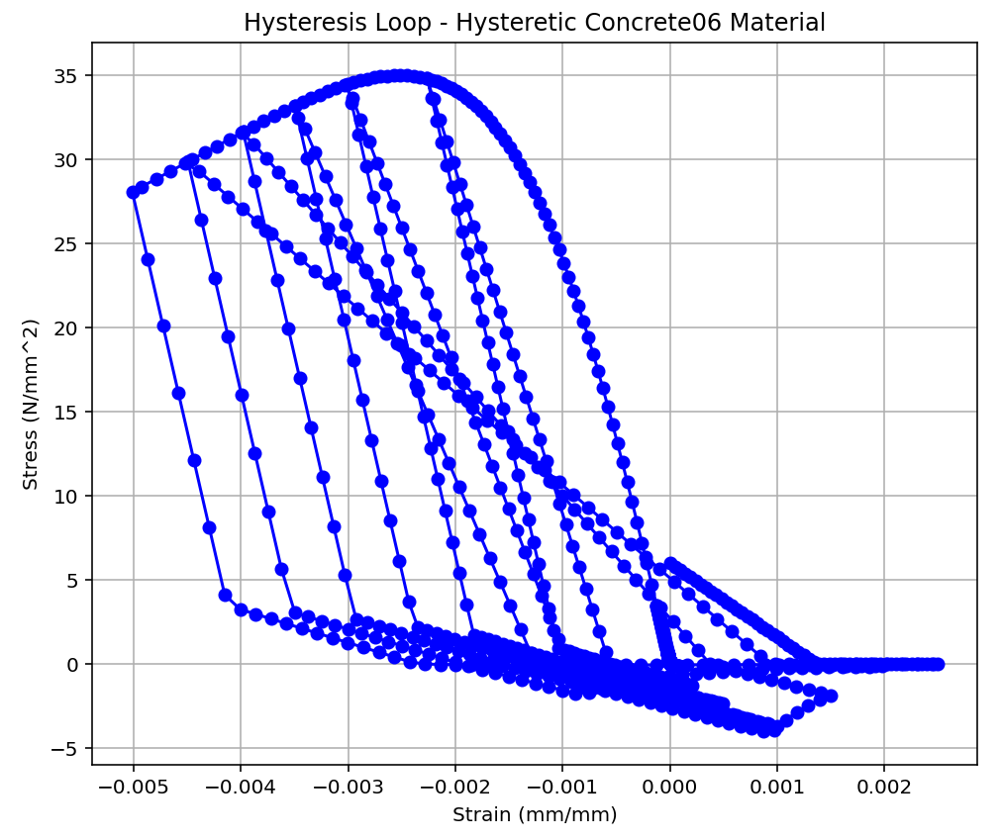
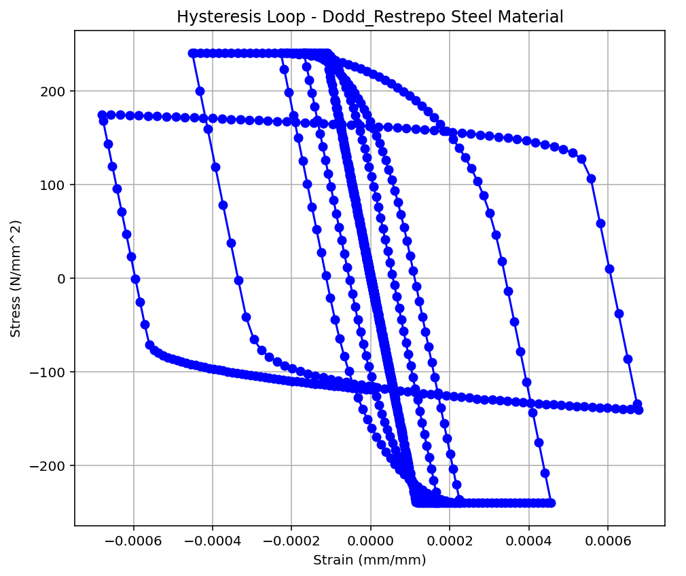
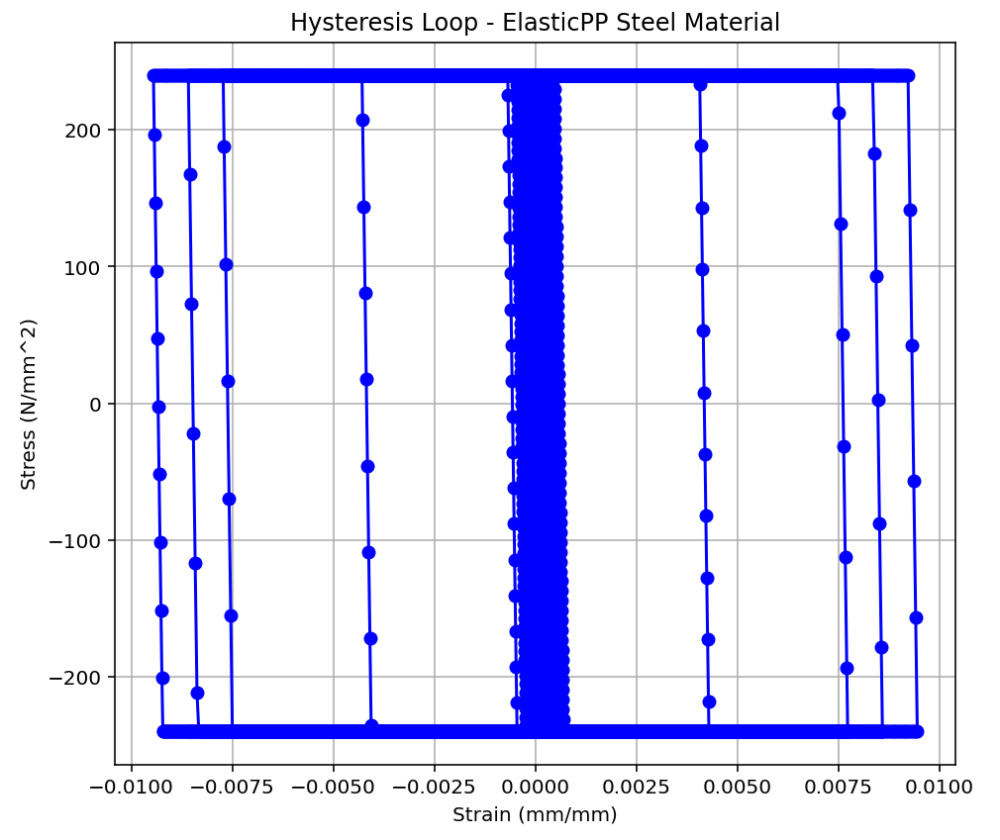
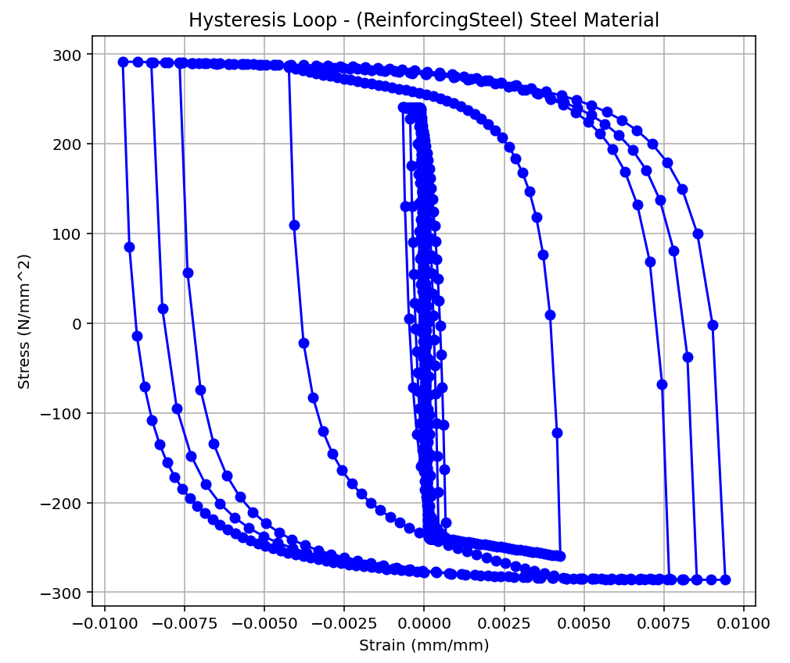
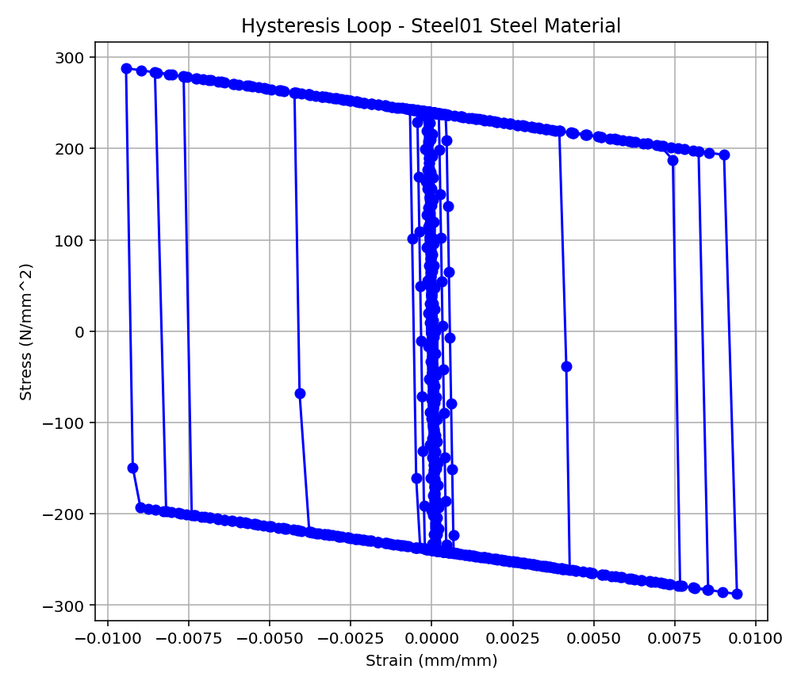
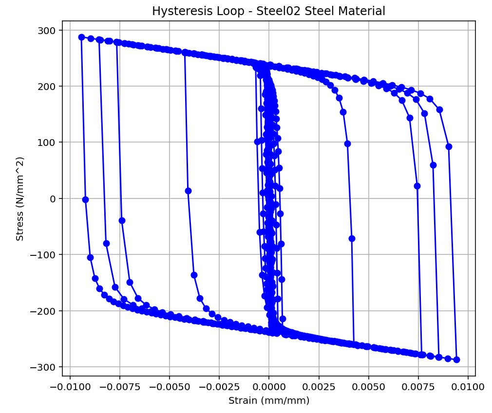

# HYSTERETIC STRESS–STRAIN BEHAVIOR OF STRUCTURAL MATERIALS

## Overview

This directory contains Python scripts and graphical results for visualizing the hysteretic stress–strain behavior of structural materials using examples associated with OpenSees material models.

The primary objective is to illustrate how different constitutive models represent material response under loading and unloading, including elastic behavior, yielding, nonlinear hardening, stiffness changes, and cyclic hysteresis where applicable.

The examples focus on concrete and steel materials commonly encountered in nonlinear structural analysis, providing a visual reference for understanding and comparing their constitutive responses.

**Author:** Salar Delavar Ghashghaei (Qashqai)

**Repository:** [OPENSEES_SALAR](https://github.com/salardelavar/OPENSEES_SALAR)

**Folder:** `PLOT_STRAIN-STRESS_HYSTERETIC_BEHAVIOR`

---

## 1. Objectives

The examples are intended to support:

- Visualization of stress–strain relationships for concrete and steel material models.
- Understanding of elastic and inelastic constitutive behavior.
- Examination of yielding, nonlinear response, and post-yield behavior where represented by the selected model.
- Comparison of different material formulations used in nonlinear finite-element analysis.
- Educational study of material behavior relevant to structural and earthquake engineering.
- Development and verification of material-response plotting workflows in Python.

## 2. Material Models and Visualization Results

### 2.1. Steel Material: HystereticSM

This example illustrates the stress–strain response associated with the `HystereticSM` material model. The model is intended to represent nonlinear hysteretic behavior, with its response governed by the specified material parameters.

### 2.2. Steel Material: Hysteretic

This example presents the response associated with the `Hysteretic` material model, which can represent nonlinear loading and unloading behavior, including pinching and cyclic degradation effects when appropriately specified.

### 2.3. Concrete01 Material

The `Concrete01` model represents uniaxial concrete behavior with a nonlinear compressive envelope and degrading response characteristics. Its formulation does not include tensile strength.

### 2.4. Concrete02 Material

The `Concrete02` model represents nonlinear concrete behavior with a tensile-strength branch and tension-softening response, in addition to its compressive constitutive behavior.

### 2.5. Concrete04 Material

The `Concrete04` model provides a nonlinear uniaxial concrete formulation based on the Popovics compressive stress–strain relationship, with tensile behavior defined by the model formulation.

### 2.6. Concrete06 Material

This example illustrates the stress–strain response associated with the `Concrete06` material formulation, allowing users to examine its specified constitutive behavior.

### 2.7. Dodd–Restrepo Steel Material

This example presents the stress–strain behavior associated with the Dodd–Restrepo material formulation, which is relevant to studying nonlinear reinforcing-steel response.

### 2.8. ElasticPP Material

The `ElasticPP` model represents elastic-perfectly plastic behavior. It is useful for studying the transition from the elastic range to plastic deformation without introducing a post-yield hardening branch.

### 2.9. ReinforcingSteel Material

The `ReinforcingSteel` model is intended to represent the nonlinear uniaxial response of reinforcing steel. Depending on the selected parameters and options, its formulation can represent yielding, hardening, and additional features of reinforcing-steel behavior.

### 2.10. Steel01 Material

The `Steel01` model represents bilinear steel behavior with kinematic hardening. It is commonly used to model yielding and post-yield response in nonlinear structural analysis.

### 2.11. Steel02 Material

The `Steel02` model uses the Giuffré–Menegotto–Pinto formulation to represent nonlinear steel behavior, including smooth transitions between elastic and post-yield branches and isotropic hardening effects when activated.

---

## 3. Python Scripts

The directory includes individual Python scripts corresponding to the material-response examples:

| Material model | Python script |
|---|---|
| HystereticSM | `PLOT_HYSTERETICSM_BEHAVIOR _STEEL _MATERIAL.py` |
| Hysteretic | `PLOT_HYSTERETIC_BEHAVIOR _STEEL _MATERIAL.py` |
| Concrete01 | `PLOT_HYSTERETIC_BEHAVIOR_CONCRETE01_MATERIAL.py` |
| Concrete02 | `PLOT_HYSTERETIC_BEHAVIOR_CONCRETE02_MATERIAL.py` |
| Concrete04 | `PLOT_HYSTERETIC_BEHAVIOR_CONCRETE04_MATERIAL.py` |
| Concrete06 | `PLOT_HYSTERETIC_BEHAVIOR_CONCRETE06_MATERIAL.py` |
| Dodd–Restrepo | `PLOT_HYSTERETIC_BEHAVIOR_Dodd_Restrepo_MATERIAL.py` |
| ElasticPP | `PLOT_HYSTERETIC_BEHAVIOR_ElasticPP_MATERIAL.py` |
| ReinforcingSteel | `PLOT_HYSTERETIC_BEHAVIOR_ReinforcingSteel_MATERIAL.py` |
| Steel01 | `PLOT_HYSTERETIC_BEHAVIOR_STEEL01_MATERIAL.py` |
| Steel02 | `PLOT_HYSTERETIC_BEHAVIOR_STEEL02_MATERIAL.py` |

The scripts can be used as starting points for exploring constitutive models, modifying material parameters, and generating stress–strain plots. Consult the individual scripts for their specific implementation details and dependencies.

## 4. Engineering Applications

Understanding material stress–strain behavior is fundamental to nonlinear finite-element modeling. These examples can support the following activities:

1. **Constitutive modeling:** Understanding the relationship between strain and stress in uniaxial material formulations.
2. **Nonlinear static analysis:** Selecting appropriate material models for pushover and monotonic loading simulations.
3. **Cyclic analysis:** Investigating loading–unloading response and hysteretic behavior for models that support cyclic response.
4. **Earthquake engineering:** Studying the material-level mechanisms that influence structural response under reversed cyclic loading.
5. **Model verification:** Comparing plotted responses with expected constitutive behavior and relevant reference data.

The plots should be interpreted in the context of each material model's assumptions and parameters. Similar-looking curves do not necessarily imply equivalent unloading rules, degradation mechanisms, or energy-dissipation characteristics.

## 5. Software and Requirements

The examples are based on Python scripts. Depending on the implementation of each script, the following packages may be required:

- Python 3.x
- NumPy
- Matplotlib
- OpenSeesPy, if the script performs material or structural analysis through OpenSees

Install only the dependencies required by the particular example. The PNG files are provided as visual references and can be viewed without running the scripts.

## 6. Limitations and Verification

These examples are intended for educational and research purposes. The plotted results depend on the constitutive formulations, input parameters, loading protocols, numerical implementation, and plotting procedures used in each script.

Before using any material model in engineering applications, users should:

- Verify the input parameters and units.
- Check the model formulation against the relevant OpenSees documentation.
- Confirm the expected behavior under monotonic and cyclic loading, as applicable.
- Compare numerical results with analytical expectations, published experimental data, or established benchmark examples.
- Avoid treating a visual match alone as proof of model validation.

These examples do not replace material calibration, experimental validation, or independent verification of a nonlinear structural model.

## 7. License and Citation

This project is part of the open-source educational repository [OPENSEES_SALAR](https://github.com/salardelavar/OPENSEES_SALAR).

Please refer to the repository's [LICENSE](https://github.com/salardelavar/OPENSEES_SALAR/blob/main/LICENSE) for applicable terms of use.

If these scripts or plots are used in research, teaching, or derivative projects, acknowledge the original author and cite the repository.

**Author:** Salar Delavar Ghashghaei (Qashqai)

**GitHub:** https://github.com/salardelavar

**Repository:** https://github.com/salardelavar/OPENSEES_SALAR

