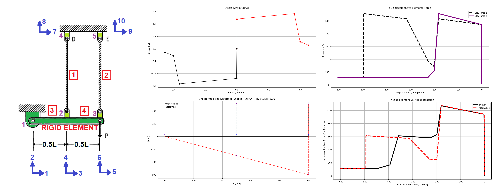
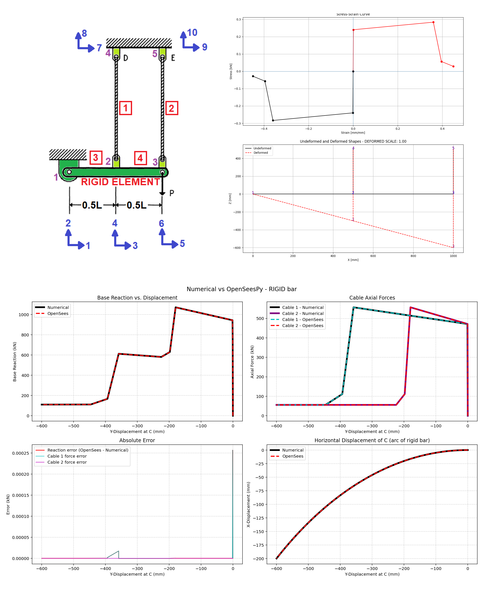

# PUSHOVER ANALYSIS OF CABLE SUBJECTED TO LATERAL DISPLACEMENT, MATERIAL AND GEOMETRIC NONLINEARITY EFFECTS, AND DISPLACEMENT CONTROL VERIFICATION USING OPENSEES

# EXAMPLE: TWO_CABLES_RIGID_BODY
 

# EXAMPLE: TWO_CABLES_RIGID_BODY_TWO
 

THIS PYTHON SCRIPT IS WRITTEN BY SALAR DELAVAR GHASHGHAEI (QASHQAI)
