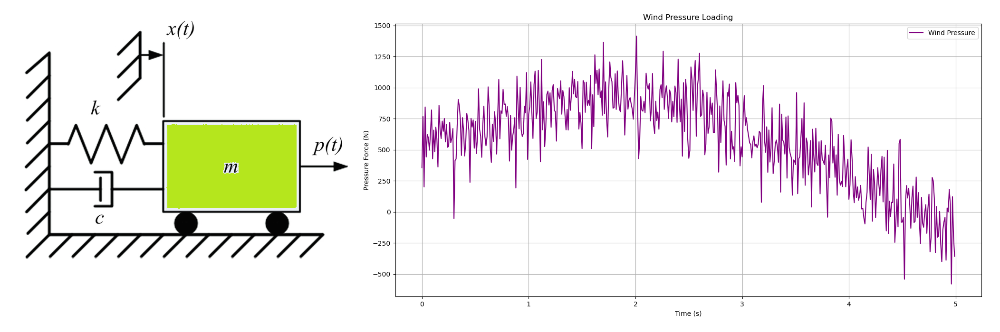

# NONLINEAR DYNAMIC ANALYSIS ON CONCRETE CONFINED SECTION COLUMN WITH UNCERTAINTY CONDITIONS USING PROBABILITY DISTRIBUTION FUNCTION MONTE CARLO METHOD 

 

 
THIS PYTHON SCRIPT IS WRITTEN BY SALAR DELAVAR GHASHGHAEI (QASHQAI)
